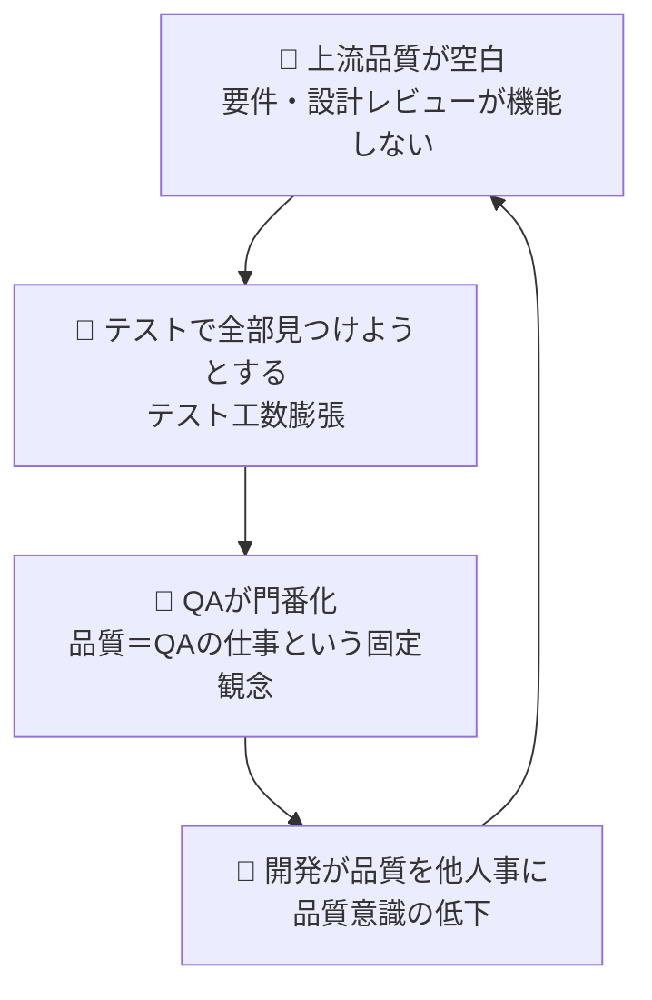

:::message
この章のポイント: 「QA＝テスト」の等式を放置すると、組織に3つの構造的負債が蓄積する。門番化・テスト偏重・人材固定化。
:::

## 2-1. なぜ「負債」と呼ぶのか

技術的負債という言葉がある。今は動くコードだけど、設計が雑で、後から修正するときに余計なコストがかかる。エンジニアなら聞いたことがある人も多い。

:::message
**技術的負債って何？**
プログラムを書くとき、「今すぐ動けばいい」と急いで書いたコードは、後から直すのがすごく大変になる。これを「借金」にたとえた言葉が技術的負債。借金と同じで、放っておくと利子がどんどん膨らんでいく。
:::

この本で扱うのは「品質の負債」だ。QA＝テストの等式を放置し続けたとき、組織に積もっていく構造的な問題。技術的負債と同じで、今すぐ困るわけではない。テストを実行して、バグを報告して、直して、リリースする。回っているように見える。

しかし、利子は確実についている。

クレジットカードの利子を想像してほしい。毎月の最低返済額だけを払い続ける。今月の支払いは楽だ。しかし、元本は減らない。むしろ利子で残高が増えていく。ある日明細を見て驚く。「こんなに残ってたのか」。

QA＝テストの組織は、品質に対して最低返済額だけを払い続けている状態だ。テスト実行という「今月の支払い」はしている。しかし、品質を根本から良くする活動（元本返済）はしていない。

[第1章](/books/testing-not-equals-qa/chapter1)で見た4つの症状を思い出してほしい。テストケースが増えても品質が変わらない。同じパターンのバグが繰り返される。リリース直前にしか品質の話をしない。QAチームがテスト実行チームになっている。

これらは負債の「利子の現れ」だ。症状が見えているのに、対処が「テストをもっとやる」では、返済額を増やしているだけで元本には触れていない。

この章では、利子ではなく元本を見る。QA＝テストの等式が、組織にどんな構造的な負債を積み上げているのか。3つの負債に分解して、1つずつ見ていく。

| 負債 | 一言でいうと | 勉強のたとえ |
|---|---|---|
| 負債1：門番化 | QAが品質の最終判断者になる | 先生がいないと勉強できない |
| 負債2：上流空白 | テスト以前に品質を確認しない | 授業中に理解せず試験で勝負 |
| 負債3：テスト工数誤認 | テスト量＝品質投資と思い込む | 問題集を解く量だけ増やす |

順番に見ていこう。

## 2-2. 負債1：QAが「最後の門番」になる

ある組織の話を聞いてほしい。

QAチームの田中さん（仮名）は、5年間そのプロダクトを見てきたベテランだ。仕様も過去のバグも、テスト観点もすべて田中さんの頭の中にある。リリース前には田中さんが最終確認し、「OK」と言えばリリースできる。「NG」と言えば延期。チーム全員が田中さんの判断を信頼している。

一見、うまくいっている。

田中さんが産休に入った月、リリースが2回延期になった。田中さんがいないと、何をどこまでテストすればリリースしていいか、誰も判断できなかった。品質基準も、テスト範囲の決め方も、すべて田中さんの経験則に依存していた。

これが「最後の門番」化だ。

### なぜ門番化が起きるのか

QA＝テストの組織では、品質を確認する場所が1つしかない。開発が終わった後の「テストフェーズ」だ。

開発チームはコードを書く。書き終わったらQAチームに渡す。QAチームがテストして、バグを見つけて、開発チームに返す。開発チームが直す。QAチームが確認する。問題なければリリース。

この流れの中で、品質の最終判断は常にQAチームの手にある。QAが「OK」と言わない限りリリースできない。QAチームは品質の「最後の門番」になる。

門番が1人しかいなければ、その人に依存する。2人いても、経験の差で「結局あの人が見ないと不安」となる。時間が経つほど、門番への依存は深まっていく。

門番化は組織の自然な成り行きでもある。プロダクトが成長するにつれ、仕様は複雑になる。テスト範囲は広がる。過去のバグ履歴は積み重なる。これらの知識を全員で共有するのは現実的に難しい。結果として、最も長くプロダクトを見てきた人に知識が集中する。意図して門番にしたわけではなく、気づいたら門番になっていた。

### 開発チームの品質意識が育たない

門番化の怖いところは、開発チーム側の変化だ。

「QAチームが確認してくれるから大丈夫」。

この意識が定着すると、開発者自身がテストする動機が薄れる。ユニットテストは書くけれど、それは「自分のコードが動くことの確認」であって、「ユーザーにとっての品質」まで考えていない。境界値はどうか。異常系はどうか。他の機能との組み合わせはどうか。「そこはQAが見てくれるでしょ」。

勉強のたとえで言えば、先生（QA）が毎回答え合わせしてくれるから、自分では答え合わせしない状態だ。先生がいないと、自分の理解度がわからない。先生に頼り切った生徒は、自分で学ぶ力を失っていく。

ある現場では、開発者がPull Requestの説明に「テスト確認はQAにお任せします」と書いていた。悪気はない。役割分担だと思っている。しかし、品質を他人事にしている。この認識が組織に浸透すると、品質は「QAの仕事」になり、開発チームは品質から距離を置くようになる。

結果として、品質に関する知識はQAチームにだけ蓄積される。開発チームには品質のナレッジがない。QAの人が退職すれば、プロダクトの品質に関する知識が組織から消える。

こういうやりとりが日常になっていないか。

> 開発者「この機能、テストどこまでやればいいですか？」
> QA「前にも似たバグがあったので、決済フローとの連携部分は重点的に見ます。ログイン状態の組み合わせも要注意です」
> 開発者「了解です。じゃあそこはお任せします」

「お任せします」。この一言が門番化を加速させる。開発者は自分のコードが決済フローにどう影響するかを考える機会を失う。QAは毎回同じ判断を1人で繰り返す。本来なら「なぜ決済フローが壊れやすいのか」を開発者と一緒に考えて、設計レベルで対処すべきところだ。しかし「お任せします」が定着した組織では、その対話自体が生まれない。

健全なチームでは同じ場面がこうなる。「決済フローとの連携部分は前にも壊れたことがあります。今回の変更、一緒にコードを見ながらどこが影響するか確認しませんか？」。品質の判断を共有する。この違いが、半年後のチームの品質力を大きく分ける。

### 門番化は「成功」の仮面をかぶっている

門番化がやっかいなのは、短期的にはうまく機能することだ。

経験豊富な田中さんがテストすれば、リリース品質は安定する。バグの見落としは少ない。チームは安心してリリースできる。KPIも良好だ。リリース後の障害件数は少ない。

問題は、この「成功」が門番への依存を強化することだ。「田中さんのおかげで品質が保たれている」。この評価は正しい。しかし「田中さんがいなくても品質が保たれる仕組み」は何もできていない。

門番の成功体験が長く続くほど、組織は仕組みづくりを怠る。田中さんの判断基準を文書化しよう、テスト設計のナレッジを共有しよう、リリース判定の基準を定量化しよう。こういう話は「田中さんがいるからいい」で後回しになる。

そして、田中さんがいなくなったとき、後回しにしていたツケが一気に来る。

### 門番化のサイン

自分の現場で門番化が起きているかどうか、いくつかのサインがある。

リリース前の最終週にバグ報告の50〜70%が集中している。これは品質確認がリリース直前に集中している証拠だ。もっと早い段階で品質を確認していれば、バグの発見は分散するはずだ。

特定の人がいないとリリース判断ができない。テスト範囲を決められない。過去のバグの傾向を知っている人が1人しかいない。これらはすべて門番化のサインだ。

もう1つ、地味だが重要なサインがある。QAチームのメンバーが休暇を取りづらいと感じていること。「自分が休むとリリースが止まる」。この感覚を持っている人がいたら、門番化はかなり進行している。

### 門番化の進行レベル

門番化は一晩で起きない。段階的に進行する。

| レベル | 状態 | 組織への影響 |
|---|---|---|
| Lv1: 質問集中 | 「あの人に聞けば早い」が定着 | 回答待ちで他メンバーの手が止まる |
| Lv2: 承認依存 | その人の承認がリリース条件に | 不在時にリリースが延期される |
| Lv3: 暗黙基準 | 判断基準がその人の頭の中だけにある | 異動・退職で品質の基盤ごと失われる |
| Lv4: 権威化 | 「あの人がOKなら大丈夫」が組織の公式ルールに | 品質基準の議論自体が消滅する |

Lv1の段階で気づけば対処はしやすい。しかし、Lv1の状態は「チームにとって便利」なので、誰も問題視しない。便利さが依存を深め、気づいたときにはLv3に到達している。

自分のチームがどのレベルにいるか、考えてみてほしい。レベルが上がるほど、戻すのに時間がかかる。Lv1なら1ヶ月で改善できるが、Lv3からの回復には半年以上かかることもある。

### ドキュメント化では解決しない

「田中さんの知識を文書化すればいい」と思うかもしれない。テスト設計のナレッジを文書にする。品質基準をドキュメントに残す。リリース判定の手順書を作る。

実際、多くの組織がこのアプローチを試みる。そして、たいてい失敗する。

理由は2つある。1つは、暗黙知の量が膨大すぎること。5年間プロダクトを見てきた田中さんの頭の中には、文書化できない膨大な経験則がある。「この機能はあのAPIとの組み合わせで壊れやすい」「このパターンの変更はログイン周りに影響する」「以前こういう条件でバグが出たから、ここは重点的に見る」。こういった判断の根拠を全部文書化するのは現実的ではない。

もう1つは、文書化しても読まれないこと。500ページのテストナレッジ文書ができたとして、新しいメンバーがそれを読んで田中さんと同等の判断ができるようになるか。ならない。文書は参照されなければ意味がない。そして、量が多い文書ほど参照されない。

門番化の根本的な解決は、特定の人の知識に依存する構造そのものを変えることだ。品質の判断基準を定量化し、プロセスに組み込む。テスト戦略をチームで共有する。品質の知識を1人に集中させず、チーム全体に分散させる。これらの具体的な方法は[第3章](/books/testing-not-equals-qa/chapter3_1)以降で扱う。

### 門番は「悪者」ではない

補足しておきたいことがある。門番になっている人は、たいてい責任感が強く、品質に真剣な人だ。サボっているから門番になったのではなく、誰よりも品質を大事にしているからこそ門番になった。

問題は個人ではなく構造にある。門番化は「その人が悪い」のではなく「品質を仕組みで支える体制がない」から起きる。門番本人も「自分がボトルネックになっている」と感じていることが多い。しかし「自分がやらないと品質が下がる」という現実がある限り、手を離せない。

門番化を解消するとは、門番の役割を奪うことではない。門番が持っている知識と判断基準を「チームの共有財産」に変えることだ。門番だった人は、品質の仕組みを設計する側に回れる。テスト実行者からテスト戦略家へのシフト。[第6章](/books/testing-not-equals-qa/chapter6)で扱うキャリアの話にもつながる。

## 2-3. 負債2：テスト以前の品質活動が空白になる

ソフトウェア開発のバグには、不思議な性質がある。見つかるのは後半なのに、原因は前半にある。

テストフェーズで見つかったバグを追跡してみると、原因の多くは要件定義や設計の段階にある。要件があいまいだった。設計が仕様を網羅していなかった。例外ケースの定義がなかった。

:::message
**上流・下流って何のこと？**
ソフトウェア開発の工程を川の流れにたとえた言い方。上流＝要件定義・設計など「何を作るか決める」工程。下流＝実装・テストなど「実際に作って確認する」工程。バグの「原因」は上流に多く、「発見」は下流になりがち。
:::

バリー・ボームという研究者が、バグの修正コストと工程の関係を調べた。結果はこうだ。

要件定義の段階で見つけて直せばコスト1。設計段階なら5倍。実装段階なら10倍。テスト段階なら30〜70倍。リリース後なら100倍以上。

数字の正確さは議論があるが、「後から直すほど高くつく」という構造は、現場感覚としても間違っていない。テストで見つかったバグを修正するとき、コードを書き直すだけでは済まないことがある。設計をやり直す。影響範囲を調査する。他の機能との整合性を確認する。テストケースを書き直す。関係者にレビューを依頼する。1つのバグの修正に、何人もの工数がかかる。

### 「テストで見つければいい」が暗黙の前提になる

QA＝テストの組織では、QAの出番はテストフェーズ以降だ。

要件定義のレビューにQAの視点はない。設計レビューにテスト観点は持ち込まれない。「テスト可能かどうか」を設計段階で誰も確認しない。

結果として、テストフェーズに入ってから「これ、テストできません」と気づくことになる。

たとえばこういう要件がある。「同時接続が多い場合に、負荷が高くならないこと」。

一見すると品質要件に見える。しかし、テストの目で見ると穴だらけだ。「多い」は何人？ 100人？ 1,000人？ 10,000人？ 「高くならない」はどの程度？ レスポンス3秒以内？ 5秒以内？ そもそもどこで測る？

:::message
**テスト可能性（Testability）って何？**
「テストできるように書いてあるか」ということ。「使いやすいこと」は数値で測れないのでテストしにくい。「画面表示が2秒以内であること」は測定できるのでテストしやすい。曖昧な要件はテストのしようがない。
:::

テストフェーズで初めてこの問題に気づく。要件を書いた人に確認する。もう異動している。仕様書には書いてない。「たぶん100人くらいだと思います」。この「たぶん」でテストケースを書く。テスト結果の判定も「たぶん大丈夫」になる。

これが「上流の品質活動が空白」な状態だ。要件定義の段階で品質の目を入れていれば、「同時接続100人・レスポンス3秒以内・APIサーバーのP95で測定」と具体化できた。テストフェーズで慌てる必要はなかった。

上流で品質の目を入れたときと入れなかったとき、要件がどう変わるかを比べてみよう。

| 曖昧な要件（上流空白） | 具体化された要件（上流に品質の目あり） |
|---|---|
| 同時接続が多い場合に負荷が高くならないこと | 同時接続100人でAPIレスポンスP95が3秒以内 |
| 使いやすいログイン画面 | ログイン操作が3ステップ以内で完了すること |
| データが安全に保存されること | 個人情報はAES-256で暗号化し、アクセスログを90日保持 |
| エラーが起きたら適切に対応すること | 決済エラー時はリトライ1回、失敗なら注文保留状態にしユーザーに通知 |
| 速く動くこと | トップページの表示がLCP 2.5秒以内（モバイル回線） |

左側の要件でテストケースを書けと言われたら、テスターは途方に暮れる。「適切に」「安全に」「速く」。全部テスターの解釈次第だ。右側なら、数字で合否を判定できる。テスト設計の時間も大幅に短縮される。

この差は、要件を書く段階で「テストの目」が入ったかどうかだけで生まれる。難しい技術は不要だ。「これ、どうやってテストしますか？」と1回聞くだけでいい。

たとえばこんな場面を想像してほしい。要件レビューの場で、仕様書に「エラーが起きたら適切に対応すること」と書いてある。

誰かが「これ、テストするときどうやって合否を判定しますか？」と聞く。書いた人が「うーん、エラーメッセージを出す感じで」と答える。「どんなメッセージですか？ ユーザーは次に何をすればいいかわかりますか？」と続ける。5分のやりとりで「決済エラー時はリトライ1回、失敗なら注文を保留にしてユーザーにメールで通知する」という具体的な仕様が生まれる。

この5分がなければ、テストフェーズに入ってから同じ議論を、実装済みのコードを前にしてやることになる。実装済みの仕様を変えるコストは、要件段階で変えるコストの何倍もかかる。

### もう1つの「空白」

要件の曖昧さだけが上流の問題ではない。もっと根本的な空白がある。

「そもそもこのプロダクトにとって品質とは何か」が定義されていない。

品質と聞くと「バグがないこと」を思い浮かべる人が多い。しかし、品質にはもっと多くの側面がある。性能は十分か。セキュリティは大丈夫か。使いやすいか。アクセシビリティは確保されているか。データの整合性は保たれているか。障害からの復旧は素早いか。

QA＝テストの組織では、これらの品質の側面がどの程度重要かを誰も定義していない。結果として、テストフェーズでテスターが「何を重点的にテストするか」を自分の判断で決めることになる。ある人は画面の見た目を重視し、別の人は機能の正確さを重視する。チームとして何を守りたいのかが合意されていないから、テストの方向がばらける。

具体的に言うと、ECサイトを開発しているチームで「品質とは何か」を3人に聞いたらこうなる。開発者は「バグがないこと」。デザイナーは「使いやすいこと」。事業責任者は「売上に影響する障害が起きないこと」。3人とも正しいが、優先順位がばらばらだ。限られたテスト時間で何を重点的に確認するか、このままでは決められない。

品質の定義は[第4章](/books/testing-not-equals-qa/chapter4)で詳しく扱うが、ここで言いたいのは「品質の定義が不在」という上流の空白が、テストフェーズのカオスを生んでいるということだ。

### 予防と検出の違い

勉強のたとえに戻ろう。

テストは期末テスト、答え合わせはその結果を見て間違いを確認すること。ここまでが検出（Detection）だ。

成績を本当に上げたいなら、テストの前にやることがある。授業中にわからないところを質問する。教科書で予習する。先生の説明を聞いて理解する。問題が起きる前に手を打っておく。こちらが予防（Prevention）だ。

どちらが効率的か。

10個のバグをテストで見つけて、10個を修正する。修正にかかるコストを1個あたり5人日とすると、合計50人日だ。一方、上流の品質活動で10個のバグのうち7個を予防できたとする。予防にかかるコストが全体で10人日、残り3個のバグの修正が15人日。合計25人日。半分で済む。

数字は仮の話だが、構造は現実にもあてはまる。ボームの研究が示す「後工程ほどコスト増」を踏まえれば、早い段階で問題を防いだ方が総コストは低い。

QA＝テストの組織は、検出（テスト）に全力を注ぎ、予防（上流での品質活動）をしていない。期末テストの答え合わせだけ一生懸命やって、授業中の理解や予習はまったくやっていない状態だ。それで成績が上がるはずがない。

上流の品質活動とは何か。要件レビュー、設計レビュー、リスク分析、テスト戦略の策定、品質基準の定義。いずれもテスト実行より前の工程で行う活動だ。QA＝テストの等式の中にいると、これらの活動が存在すること自体が見えない。[第3章](/books/testing-not-equals-qa/chapter3_1)で品質活動のカタログを一覧するが、その半分以上はテスト実行より前の工程に位置する活動だ。

### アジャイルでも上流は存在する

「うちはアジャイルだから上流・下流の区別はない」。こう言う人もいる。

確かにアジャイル開発では、ウォーターフォールのように工程を明確に分けない。2週間のスプリントの中で、仕様検討もコーディングもテストも行う。

しかし、スプリントの中にも「上流」はある。ストーリーの受け入れ基準を書く段階。設計方針をチームで話し合う段階。コードを書き始める前の段階。ここに品質の目を入れるかどうかで、スプリント後半のテストの質が変わる。

アジャイルチームでよく見る問題の1つが、ストーリーの受け入れ基準が曖昧なままスプリントに入ることだ。「ユーザーが商品を購入できること」。これだけで開発が始まる。購入フローの途中でエラーが起きたらどうする？ 在庫切れの場合は？ 同時に複数人が購入したら？ テスト段階で「この場合どうなるべきですか？」と聞く。プロダクトオーナーが「うーん、エラーメッセージ出してください」と答える。仕様がテストフェーズで決まっていく。

スプリントが短くなっても、上流の品質活動の空白は解消されない。短い周期で回る分、空白の影響が毎スプリント繰り返される。

2週間スプリントの典型的な時間配分を見てみよう。

| 日程 | 上流に品質の目がないチーム | 上流に品質の目があるチーム |
|---|---|---|
| Day 1（計画） | ストーリーを読んで見積もる | ストーリーの受け入れ基準を全員でレビュー |
| Day 2〜7（開発） | 実装に集中。品質の話は出ない | 実装中にテスト観点をメモ。設計段階でQAがフィードバック |
| Day 8〜9（テスト） | 「仕様ってどうでしたっけ？」連発 | 受け入れ基準に基づいてテスト実行。曖昧さが少ない |
| Day 10（リリース判定） | 「まだバグが…延期しましょう」 | 品質基準をクリアしたものをリリース |

左側のチームはDay 8から慌てる。右側のチームはDay 1の計画段階で品質の仕込みをしている。Day 1に品質の目を入れる追加コストは30分程度。その30分が、Day 8以降の「仕様確認待ち」を2〜3時間減らす。

## 2-4. 負債3：テスト工数が品質投資だと思い込む

こういう報告を見たことはないだろうか。

「今回のリリースでは10,000件のテストケースを実行しました。パス率は99.5%です」

数字だけ見ると安心する。10,000件のテストが99.5%通った。5件しか失敗していない。品質は十分だ。

ところが、リリース後の1ヶ月で本番障害が5件発生し、ユーザーからの問い合わせが週20件入る。

何が起きたのか。

テストで測れていなかった品質がある。テストケース10,000件は、テストが「カバーした」範囲の話でしかない。カバーしていない範囲で何が起きているかは、テストケースの数からはわからない。

テストケース数が品質の指標になっている組織は多い。「前回より2,000件増やしました」「テスト密度は要件あたり50件です」。これらの数字は安心感を生む。しかし、リリースへの確信にはならない。

:::message
**テスト密度って何？**
「要件1つあたり何件のテストケースがあるか」を測る指標。テスト密度が高い＝テストが多い＝品質が高い、と思われがちだが、実際にはテストの質（何を確認しているか）の方が重要。100件の形式的なテストより、10件の的確なテストの方が品質に効く。
:::

### 量の錯覚

問題集のたとえで考えてみよう。

試験勉強をしている。問題集を5冊買ってきた。1冊200問。合計1,000問を解いた。「1,000問やったから大丈夫」。こう思う。

しかし、5冊の問題集が全部同じ範囲をカバーしていたらどうか。微分積分の問題ばかり1,000問解いて、線形代数は1問もやっていない。試験に線形代数が出たら全滅だ。

テストケースの件数が多いことと、テストが品質を十分にカバーしていることは、まったく別の話だ。

自分が自社で21.5万件のテストケースを分析したとき、約75%が削減可能だった。重複、冗長、形骸化した古いテストケース。テスト件数を増やし続けた結果、実行にかかる時間とコストが膨らんでいた。テスト工数の大半が、品質への貢献が低いテストケースの消化に使われていた。

この話は[第5章](/books/testing-not-equals-qa/chapter5_1)で詳しく扱う。ここで言いたいのは、テストケースの数は「品質への投資額」ではないということだ。10,000件のテストケースを実行するのに100人日かかったとして、その100人日が品質に100人日分の効果をもたらしているとは限らない。

### 「テスト充足感」という罠

テストを大量に実行すると、安心感が生まれる。「これだけやったんだから大丈夫だろう」。自分はこれを「テスト充足感」と呼んでいる。

テスト充足感は危険だ。実際の品質と関係なく、テストを実行した量だけで安心してしまう。パス率99.5%は確かに高い。しかし、残りの0.5%（50件）が致命的なバグかもしれない。あるいは、テストケースがカバーしていない領域にもっと多くのバグが潜んでいるかもしれない。

テスト充足感の怖いところは、リリース判断に影響することだ。「テスト完了率100%、パス率99.5%」と報告されたら、マネージャーは「リリースOK」と判断しやすい。数字が安心感を生む。しかし、その数字は「テストが測った範囲」での結果にすぎない。

[第1章](/books/testing-not-equals-qa/chapter1)の勉強のたとえを使えば、自分が解いた問題集では95点だった。しかし、本番の試験範囲と問題集の範囲がずれていた。本番は60点。問題集の点数は、本番の点数を保証しない。

### 投資配分の歪み

品質に関わる活動にかける時間の内訳を見ると、多くの組織でこうなっている。

テスト実行に全体の80%。テスト設計に15%。分析・改善に5%。

勉強に置き換えると、問題を解く時間が80%、答え合わせと間違い直しが15%、勉強法の見直しが5%だ。

問題を解くこと自体は悪くない。しかし、80%が問題を解くことに費やされ、勉強法の見直しにはほとんど時間を使わない。成績が伸び悩んでも「もっと問題を解こう」としか思いつかない。

さらに問題なのは、この投資配分が見えにくいことだ。QAチームの日報やタイムシートを見ても「テスト実行」「テスト設計」「分析」と分かれて記録されていることは稀だ。ほとんどの場合、すべてが「QA活動」として一括で記録される。テスト実行に何%使っているかを正確に測っている組織は少ない。

見えないから、問題意識も生まれない。「QAチームはちゃんと仕事している」「品質に人を配置している」。経営やマネジメントの目には投資しているように見える。しかし、その投資の中身はテスト実行の工数であって、品質を改善する活動ではない。

QA＝テストの組織で「品質を上げたい」と議論すると、出てくる案はたいてい「テストケースを増やす」「テストの人員を増やす」「テスト期間を延ばす」だ。全部テスト実行の量の話だ。テスト実行以外の品質活動に投資するという発想自体が出てこない。

品質改善ミーティングの会話が、チームの思考を映し出す。

QA＝テストの組織ではこうなる。「前回リリースで本番障害が3件出ました。対策として回帰テストを500件追加します」。件数が増えたことで「対策した」と片がつく。500件の中身が本番障害の原因を本当に防げるのかは、深く掘り下げられない。

負債を意識した組織では会話が違う。「本番障害3件の根本原因を調べました。3件とも設計レビュー時点で仕様の抜けがあった箇所です。次のスプリントから設計レビューにテスト観点チェックリストを導入します」。増やすのはテストケースではなく、上流の品質チェックだ。同じ「本番障害3件」という事実に対して、打ち手がまったく違う。

典型的な組織と、品質負債を意識している組織で、投資配分がどれだけ違うかを比較する。

| 品質活動 | QA＝テストの組織 | 負債を意識した組織 |
|---|---|---|
| テスト実行 | 80% | 40% |
| テスト設計 | 15% | 25% |
| 要件・設計レビュー | 0% | 15% |
| バグ分析・傾向分析 | 3% | 10% |
| プロセス改善 | 2% | 10% |

下の配分が「正解」というわけではない。チームやプロダクトの状況によって変わる。ただ、左のようにテスト実行が80%を占めている状態では、品質を根本的に改善する活動にリソースが回らない。

テスト実行にどれだけ投資しても、それは「問題を解いた」だけだ。品質を根本から良くするには、答え合わせ（QC）と勉強法の見直し（QA）に投資する必要がある。しかし、QA＝テストの等式の中にいると、テスト実行＝品質投資という思い込みから抜け出せない。

### テスト自動化も同じ罠に落ちる

「テスト自動化すれば品質が上がる」。この主張もよく聞く。

テスト自動化は強力なツールだ。CI/CDパイプラインに組み込めば、コードが変更されるたびに自動でテストが走る。手動テストの何十倍もの速度で回帰テストを片付けられる。

:::message
**CI/CD（継続的インテグレーション/継続的デリバリー）って何？**
コードの変更を頻繁に統合し（CI）、自動でテスト・デプロイまで行う（CD）仕組み。開発者がコードを書き終わると、自動でテストが走り、問題がなければそのまま本番環境に反映される。手動で「テストして」「デプロイして」とやらなくていい。
:::

しかし、自動化されたのは「テスト実行」だ。何をテストするか、どういう観点でテストするかは人間が決めている。テスト設計が不十分なら、不十分なテストが高速に回るだけだ。

自分が事業開発時代にテスト自動化に携わったときも、この壁にぶつかった。実行効率は10倍になったのに、投資対効果を測ると品質向上への寄与が思ったより小さい。原因は偏りだった。正常系は手厚いが、異常系や組み合わせのテストが薄い。テスト設計の質が自動化の効果の天井を決めていた。

QA＝テストの等式の中にいると、「手動がだめなら自動だ」と考える。でも手段が「テスト実行」のままなら、構造は何も変わっていない。

## 2-5. 3つの負債は雪だるま式に膨らむ

ここまで3つの負債を見てきた。実は、これらは独立していない。互いに強化し合って、悪循環をつくる。

多くの組織で、負債はこの順番で進行する。

まず上流の品質活動が空白になる（負債2）。要件定義や設計の段階で品質の目が入らないから、テストフェーズに入ってから問題が噴出する。テストで見つかるバグが増える。テストケースも増える。

テストで全部見つけようとするから、テスト工数が膨張する（負債3）。「テストケースをもっと増やさないと」「テスト期間を延ばさないと」。リソースはテスト実行に吸い込まれていく。分析や改善に回す余裕はない。

テスト実行に全リソースが集中した結果、QAチームはテスト実行チームになる。品質の最終判断がQAに集中し、門番化する（負債1）。開発チームは「QAが見てくれるから大丈夫」と品質を他人事にする。

開発チームが品質を他人事にすると、上流の品質活動はますます空白になる（→負債2に戻る）。

ループが回り始めると、自力で止めるのは難しい。

**品質負債のフィードバックループ**

「うちは門番化だけで、他の負債はない」と思うかもしれない。しかし、1つの負債は他の2つを引き寄せる。門番化が起きているということは、上流の品質活動が空白になっている可能性が高い。上流が空白なら、テスト工数は膨張しているはずだ。3つの負債は雪だるま式に膨らむ。1つだけ返済しても、残りの2つが利子を生み続ける。

具体的な数字で見てみよう。ある組織が門番化の問題を認識して、QAチームの増員を決めた。2名採用した。しかし、2名とも配属後にやるのはテスト実行だ（負債3は解消されない）。テスト実行の人手は増えたが、上流の品質活動は相変わらず空白（負債2も解消されない）。結果として、増員分のリソースはすべてテスト実行に吸い込まれ、門番化の構造は変わらない。人を増やしたのに、問題は減っていない。

なぜか。ループの中にいるまま人を追加しても、ループの回転速度が上がるだけだ。ループ自体を断ち切る必要がある。

### 負債を数字で見る

「うちにも負債があるかも」と思っても、感覚だけでは動きにくい。3つの指標で負債を定量化できる。

| 指標 | 測り方 | 負債のサイン |
|---|---|---|
| バグ発見タイミング比率 | バグ報告をフェーズ別（要件/設計/実装/テスト/本番）に集計 | テスト以降で80%以上見つかっている |
| テスト実行時間比率 | QAメンバーの活動を1週間記録（テスト実行/設計/分析/改善/その他） | テスト実行が70%以上 |
| 品質判断の属人度 | 「この人がいないとリリースできない」に該当する人数を数える | 2人以下 |

これらの数字を3ヶ月に1回測るだけでも、負債の増減が見える。特にバグ発見タイミング比率は、上流の品質活動が効いているかどうかの直接的な指標になる。テスト以前のフェーズで見つかるバグの割合が増えていれば、上流への投資が効いている証拠だ。

数字が取れなくても、チームで「この3つの質問」に答えるだけで十分だ。「バグはいつ見つかることが多い？」「テスト以外の品質活動に何時間使っている？」「リリース判断を1人でも担える人は何人いる？」。答えが「テストフェーズで」「ほぼゼロ」「1人」なら、負債は確実にある。

面白いのは、この3つの質問をチームに投げると、立場によって答えが割れることだ。マネージャーは「バグは早めに見つかっている」と思っているが、テスターは「ほぼ全部テストフェーズ」と感じている。開発者は「品質活動はそこそこやっている」と思っているが、QAは「テスト実行しかしていない」と答える。このギャップそのものが、負債の存在を示す証拠だ。

### どこから断ち切るか

ループを断ち切る方法は、この本の[第3章](/books/testing-not-equals-qa/chapter3_1)以降で1つずつ扱っていく。ここでは予告だけしておく。

**負債1（門番化）への処方箋**：品質の責任を分散させる。QAだけが品質を見るのではなく、開発チーム全体で品質に関わる。→ [第3章](/books/testing-not-equals-qa/chapter3_1)でQA活動のカタログを見る。

**負債2（上流空白）への処方箋**：品質の定義をチームで合意する。「何がOKで何がNGか」が決まっていれば、上流の段階から品質を判断できる。→ [第4章](/books/testing-not-equals-qa/chapter4)で品質定義ワークショップを実践する。

**負債3（テスト工数の誤認）への処方箋**：テスト戦略で「何をテストしないか」を決める。テスト実行の量ではなく、テストの質に投資する。→ [第5章](/books/testing-not-equals-qa/chapter5_1)でテスト戦略の立て方を学ぶ。

[第1章](/books/testing-not-equals-qa/chapter1)で「QA＝テストではない」を押さえた。この章で「放置すると組織に何が起きるか」を見た。次は「ではどうすればいいか」だ。[第3章](/books/testing-not-equals-qa/chapter3_1)では、テスト以外にどんな品質活動があるのかを一覧する。

## 用語解説

:::message
**構造的負債（Structural Debt）**
技術的負債のアナロジーで、組織の構造や仕組みに潜む「今は困らないが、放置すると将来大きなコストになる問題」のこと。この本では「QA＝テスト」の等式が生む組織的な歪みを指す。借金の利子と同じで、目に見えにくいが確実に膨らんでいく。
:::

:::message
**品質ゲート（Quality Gate）**
次の工程に進んでよいかどうかを判定するチェックポイント。多くの組織では「テストに通ること」だけが品質ゲートになっている。しかし本来は、要件レビュー完了、設計レビュー完了、セキュリティチェック完了なども品質ゲートになりうる。テスト以外にも品質を確認するポイントは複数あっていい。
:::

:::message
**シフトレフト（Shift Left）**
品質活動をより早い工程（時間軸の左側）に移動させること。テストフェーズまで待たずに、要件定義や設計の段階からテスト観点を持ち込む。バグの修正コストが後工程ほど高くなることを踏まえた考え方。
:::

:::message
**手戻り（Rework）**
後の工程で見つかった問題を、前の工程に戻って修正すること。テストで見つかった設計の問題を設計からやり直す、というケース。手戻りが大きいほど、開発のコストと期間が膨らむ。手戻りを減らすには、早い段階で問題を見つけるか、そもそも問題が起きにくい仕組みをつくることが必要。
:::

:::message
**テストカバレッジ（Test Coverage）**
テストがソースコードやテスト対象のどの範囲をカバーしているかの指標。コードカバレッジ（コードの何%を実行したか）が代表的だが、要件カバレッジ（要件の何%をテストしたか）もある。カバレッジが高い＝品質が高い、ではない。カバーした範囲の中で「何をどう確認したか」が重要。
:::

:::message
**P95（パーセンタイル95）**
全体の95%がその値以下に収まるという統計指標。レスポンスタイムのP95が3秒なら、100回のリクエストのうち95回は3秒以内で返っている。平均値だと外れ値に引っ張られるため、パフォーマンス測定ではP95やP99がよく使われる。
:::

:::message
**属人化（Key Person Dependency）**
特定の人の知識や経験に業務が依存している状態。その人がいないと仕事が回らない。品質の文脈では「あの人がOKと言わないとリリースできない」という状態が典型的。
:::

:::message
**受け入れ基準（Acceptance Criteria）**
ストーリーや機能が「完成した」と判断するための条件リスト。「ユーザーがログインできること」ではなく「メールアドレスとパスワードで認証し、セッションが30分維持されること」のように、テスト可能な粒度で書く。受け入れ基準が明確なほど、テスト設計もリリース判定も楽になる。
:::

:::message
**回帰テスト（Regression Test）**
ソフトウェアの変更が、既存の機能を壊していないか確認するテスト。新機能を追加したらログイン機能が動かなくなった、というのが回帰バグの典型。変更するたびに実施するため、量が増えやすく、自動化の対象になることが多い。
:::

:::message
**バスファクター（Bus Factor）**
「チームの何人がバスに轢かれたら（＝突然いなくなったら）プロジェクトが止まるか」を数えた指標。バスファクター1なら、たった1人抜けただけでプロジェクトが止まる。門番化が進んだチームはバスファクターが1になりがち。この数字を上げるには、知識の共有と責任の分散が必要。門番化のレベル表と合わせて、自分のチームの数字を考えてみてほしい。
:::

:::message
**DORAメトリクス（DORA Metrics）**
DevOps Research and Assessmentチームが定義した、ソフトウェアデリバリーの健全性を測る4つの指標。デプロイ頻度、変更リードタイム、変更障害率、サービス復旧時間で構成される。参考文献に挙げた『Accelerate』で紹介され、業界標準として広く使われている。品質の文脈では変更障害率とサービス復旧時間が特に重要で、テスト工数の多寡よりもこちらの数字の方が品質の実態を反映する。
:::

## 悪循環ループ図

3つの負債がどうつながっているかを、2つの視点で図にした。

### バグ修正コストの工程差

ボームの研究を図にするとこうなる。要件定義で見つけたバグの修正コストを1とした場合、後の工程になるほどコストが跳ね上がる。

上流の品質活動は「バグを左に寄せる」活動だ。同じバグでも、見つかるタイミングが左にずれるだけで修正コストが桁違いに下がる。QA＝テストの組織は、この図の右側でしか品質活動をしていない。

### 循環構造

### 介入ポイント

ループのどこか1箇所を断ち切れば、悪循環は弱まる。3箇所すべてに手を打てれば、循環は止まる。

### 負債あり / 負債なしの日常

同じ「リリース前1週間」を、負債ありのチームと負債なしのチームで比べるとこうなる。

| 場面 | 負債ありのチーム | 負債なしのチーム |
|---|---|---|
| リリース1週間前 | テスト実行の真っ最中。バグが日に10件出る | テストは先週終了。残件の修正確認のみ |
| バグが見つかったとき | 「仕様どうでしたっけ？」とPOに確認 | 受け入れ基準に照らして即判定 |
| テスト範囲の決め方 | ベテランの勘。「全部やっとこう」 | テスト戦略書に基づいてリスクベースで選定 |
| リリース判定 | 「田中さん、大丈夫ですか？」 | 品質メトリクスを見て、基準値と照合 |
| リリース後 | 本番障害対応で翌週が潰れる | 品質レポートを書いて次スプリントに共有 |
| QAメンバーの有休 | 「リリース近いので無理です」 | カレンダーを見て普通に取れる |

右側が理想郷に見えるかもしれない。しかし、右側のチームも最初は左側だった。違いは「負債の存在に気づいて、少しずつ返済を始めた」かどうかだけだ。

## コラム：リリース前夜の徹夜テスト

金曜日の夜、オフィスの会議室にQAチームが集まっている。月曜のリリースに向けた最終テスト。今回も徹夜になりそうだ。

テストリーダーが進捗を確認する。「Aさん、ユーザー登録フローは？」「今70%。あと30件」。「Bさん、決済まわりは？」「ちょっと厳しいです。バグが3件見つかって、修正待ちです」。

開発チームのメンバーが社内チャットツールで修正パッチを送ってくる。QAチームが修正確認をする。修正確認の途中で別のバグが見つかる。また修正依頼を送る。リリース延期かどうかの判断は深夜2時に持ち越し。

この光景は、珍しくない。リリース前の週末にテストが終わらない。メンバーに声をかけて夜通しでテストケースを消化する。朝方にやっと「全件完了」。達成感すらある。

問題は、誰もこれを「おかしい」と思っていないことだ。「品質を守るためにがんばっている」「責任感がある」と本気で思っている。むしろ、徹夜でテストをやりきったメンバーは称賛される。「よくがんばった」「おかげでリリースできた」。

でも、これは試験前日の一夜漬けと同じ構造だ。

普段から勉強していれば、試験前日に徹夜する必要はない。普段から品質活動をしていれば、リリース前夜に徹夜テストする必要はない。

毎回リリース前に徹夜が発生するなら、それは品質活動の「仕組み」に問題がある。個人の頑張りではなく、仕組みの問題だ。

ある組織では、この徹夜テストが「文化」になっていた。リリースのたびに徹夜する。新しいメンバーが入ると「うちはリリース前は忙しいから」と当たり前のように伝えられる。3年もすると、誰もこのやり方を疑わなくなる。「うちはこういうスタイルだから」。

この徹夜は3つの負債が全部見えている場面でもある。上流で品質を確認していないから、テストフェーズでバグが噴出する（負債2）。テストで全部見つけようとするからテスト量が膨大になる（負債3）。QAチームが最終防衛ラインになっていて、彼らが「OK」と言わないとリリースできない（負債1）。

リリース前夜の徹夜は、負債の利子を一括で払わされている瞬間だ。

一括払いは痛い。そして、一括払いを繰り返すと人が疲弊する。疲弊したテスターは見落としが増える。見落としが増えるとリリース後の障害が増える。障害が増えると「もっとテストしなきゃ」と思う。悪循環だ。

普段から元本を返済しておく必要がある。どうやって？ それが[第3章](/books/testing-not-equals-qa/chapter3_1)以降のテーマだ。

## コラム：「テストケース5万件」を誇るチーム

「うちのプロダクト、テストケース5万件ありますよ」。

あるチームのリーダーが誇らしげに言った。5万件。確かに多い。1人が1日50件実行したとして、10人で100日。リリースごとに全件実行するのは現実的ではないから、「重要なもの」を選んで回帰テストに回す。

問題は「重要なもの」の基準が曖昧なことだった。3年前に作ったテストケースの半分は、仕様変更で前提が変わっている。しかし、誰も棚卸しをしていない。「消すと何かあったときに困る」。こう言って誰も手をつけない。結果として、テストケースは増える一方。5万件の中身を全部把握している人はいない。

新しいメンバーが配属されると、まず過去のテストケースを読むところから始まる。しかし5万件を読み切れるはずがない。結果として「先輩に聞く」がデフォルトになる。5万件のテストケースがあるのに、実質的にはベテランの暗黙知で回している。

テストケース件数は「資産」に見えて「負債」になりうる。メンテナンスされないテストケースは、実行するたびに誤った安心感を与える。カバーしているはずの範囲で本番障害が起きたとき、初めて「あのテストケース、仕様変更に追従してなかった」と気づく。

このチームが5万件を1万件に整理したとき、テスト実行時間は60%減った。しかし、リリース後の障害件数は変わらなかった。4万件のテストケースは品質にほぼ貢献していなかったということだ。

テストケースの数は成果ではない。品質への貢献度が成果だ。

## ワーク：自分のチームの負債を診断する

[第2章](/books/testing-not-equals-qa/chapter2)の内容を使って、自分のチームに3つの負債がどの程度あるか、診断してみよう。

各項目に「はい（○）」か「いいえ（×）」で答えてほしい。

### 負債1：門番化チェック

| # | 質問 | ○/× |
|---|---|---|
| 1 | 特定の人がいないとリリース判断ができない |  |
| 2 | テスト範囲を決められるのは限られた人だけ |  |
| 3 | バグ報告の半分以上がリリース前最終週に集中する |  |
| 4 | 「QAが見るから大丈夫」と開発チームが言う |  |

### 負債2：上流空白チェック

| # | 質問 | ○/× |
|---|---|---|
| 5 | 要件定義のレビューにQA観点で参加していない |  |
| 6 | 設計段階で「テストできるか」を確認していない |  |
| 7 | テストフェーズに入ってから仕様の曖昧さに気づくことが多い |  |
| 8 | バグの根本原因分析を定期的にやっていない |  |

### 負債3：テスト工数誤認チェック

| # | 質問 | ○/× |
|---|---|---|
| 9 | テストケースの件数が品質の指標になっている |  |
| 10 | 品質を上げる議論で出る案がテスト関連ばかり |  |
| 11 | テスト実行に時間の80%以上を使っている |  |
| 12 | テスト以外の品質活動（分析・改善）にほぼ時間を使っていない |  |

### 診断結果

**○が10個以上**：3つの負債がすべて積もっている。まずは[第3章](/books/testing-not-equals-qa/chapter3_1)のQA活動カタログで「テスト以外に何ができるか」を知ることから始めよう。

**○が6〜9個**：一部の負債が深刻。○が集中しているカテゴリ（負債1/2/3）を特定して、対応する章を重点的に読もう。

**○が5個以下**：負債は軽度。[第5章](/books/testing-not-equals-qa/chapter5_1)のテスト戦略で、さらに品質活動の精度を上げることを考えよう。

まえがきのチェックリスト（10問）と重複する問いもあるが、この章のチェックリストは3つの負債のどこに問題があるかを特定するためのものだ。「全体としてどうか」ではなく「どこから手をつけるか」を判断する材料にしてほしい。

### 結果の読み方

大事なのは合計の○の数だけではない。どのカテゴリに○が集中しているかだ。

たとえば、負債1（門番化）の4問が全部○で、負債2と3はほぼ×だった場合。品質判断が特定の人に集中しているが、上流の品質活動やテスト工数の問題はまだ深刻ではない。この場合は、まず門番化の解消から手をつける。品質の判断基準を明文化し、チーム全体で共有することだ。

負債2（上流空白）が集中している場合。テストフェーズで問題が見つかり、手戻りが多い状態。要件レビューやテスト可能性の確認を開発の早い段階に組み込むことが効果的だ。[第4章](/books/testing-not-equals-qa/chapter4)の品質定義ワークショップが直接効く。

負債3（テスト工数誤認）が集中している場合。テスト実行にリソースが偏り、分析や改善に時間を使えていない。まずテストケースの棚卸しから始める。[第5章](/books/testing-not-equals-qa/chapter5_1)のテスト戦略の考え方で、テストの質への投資にシフトする。

このワークは1人でやっても価値があるが、チームメンバーと一緒にやるとさらに効果的だ。同じ質問でも、立場が違うと答えが違う。その違い自体が、チームの品質に対する認識のずれを浮き彫りにする。

### チームで実施する場合（30分版）

| 時間 | やること |
|---|---|
| 0〜5分 | 12問のチェックリストを各自で記入。声に出さず黙々と |
| 5〜10分 | 全員の回答を表に書き出す（ホワイトボードまたは共有スプレッドシート） |
| 10〜20分 | ○×が割れた項目について、なぜ認識が違うかを議論 |
| 20〜25分 | 最も深刻だと思う負債を1つ選ぶ（ドット投票） |
| 25〜30分 | その負債に対して「来週やれること」を1つ決める |

#### よくある発見

| パターン | 意味 |
|---|---|
| 開発とQAで回答が大きく異なる | 品質に対する認識がチーム内でずれている |
| 全員が同じ項目に○をつけた | その負債は全員が問題だと感じている。着手の合意が取りやすい |
| 負債3だけ○が集中している | テスト工数の見直しから始めると効果が出やすい |
| 全項目に○がついた | 一度に全部は返済できない。まず1つ選ぶ |

議論で大事なのは「誰が悪いか」ではなく「構造のどこに問題があるか」だ。個人攻撃になりそうな空気を感じたら、ファシリテーターが「これは仕組みの問題です」と軌道修正する。

## FAQ

:::message
**テストを増やせば品質は上がるんじゃないの？**
テストは「測る」行為だ。体温計で体温を測っても、熱は下がらない。テストでバグを見つけても、見つけただけでは品質は上がらない。品質の状態を診断して制御する（QC）ことで現状が見え、バグが出にくい仕組みをつくる（QA）ことで品質が安定する。テストを増やすと「見つけられるバグ」は増えるかもしれないが、バグの発生量自体は減らない。品質を上げるには、テストの量ではなく、テスト結果をもとにした改善の量が必要だ。
:::

:::message
**少人数チームでもこの問題は起きる？**
むしろ少人数の方が起きやすい。QAが1人なら、その1人に品質判断が集中する。「QAの人が見てくれるでしょ」が暗黙の了解になりがちだ。
:::

:::message
**負債があるのはわかった。でもどこから手をつければいい？**
3つの中で、最も手をつけやすいのは負債3（テスト工数の見直し）だ。今のテストケースの中身を棚卸しして、重複や形骸化したものを整理するだけでも、テスト実行の負荷は下がる。浮いた時間を分析や改善に回せる。具体的な方法は[第5章](/books/testing-not-equals-qa/chapter5_1)で扱う。負債2（上流空白）への対策は[第4章](/books/testing-not-equals-qa/chapter4)、負債1（門番化）への対策は[第3章](/books/testing-not-equals-qa/chapter3_1)が参考になる。
:::

:::message
**うちのQAチームの人たちは優秀でちゃんと品質を守ってくれている。問題ないのでは？**
優秀な人が品質を守っている状態は、実は負債1（門番化）の初期段階でもある。その人が優秀であるほど、周囲は品質をその人に任せるようになる。その人が抜けたとき、初めて品質が属人化していたことに気づく。品質は「人」ではなく「仕組み」で守るものだ。優秀な人がいるうちに、その人の知見を仕組みに落とし込むことが重要。
:::

:::message
**開発者にテストさせるのは効率が悪いのでは？**
テスト実行だけを考えるなら、専門のテスターの方が効率的かもしれない。しかし、品質活動全体で見ると話が変わる。開発者が自分のコードの品質を意識してテストすると、バグを早い段階で見つけられる。設計段階でテスト可能性を考慮できる。コードレビューで品質の視点を持てる。テスト実行の効率は下がっても、品質活動全体の効率は上がる。大事なのは、テスト実行を全部開発者にやらせることではなく、品質の意識を開発プロセス全体に広げることだ。
:::

:::message
**マネージャーにこの負債の話をしても「テストちゃんとやってるから大丈夫」と言われそう**
数字で話すのが効果的だ。「リリース前最終週にバグ報告の何%が集中しているか」「テストで見つかったバグのうち、原因が要件・設計にあるものが何%か」「テスト実行以外の品質活動に使っている時間は全体の何%か」。感覚ではなくデータで見せると、構造的な問題が見えやすくなる。[第5章](/books/testing-not-equals-qa/chapter5_1)のテスト戦略の考え方も、マネージャーへの説明材料になる。
:::

:::message
**技術的負債と品質の負債はどう違う？**
技術的負債はコードの問題、品質の負債は組織の問題。「今は困らないが放置すると利子がつく」点は同じ。リファクタリングで返すか、品質活動の構造を変えて返すかの違いだ。両方が同時に存在することも多い。技術的負債がテスト困難なコードを生み、それがテスト工数の膨張（負債3）を加速させる。
:::

:::message
**QAチームがなくて開発者がテストもしているチームでも負債は発生する？**
する。負債1（門番化）は「テストに詳しい開発者」に品質判断が集中する形で起きる。負債2（上流空白）は開発者が「実装が終わったら自分でテストする」という流れの中で、要件や設計段階での品質確認が抜ける形で起きる。負債3（テスト工数誤認）は「テストコードのカバレッジを上げれば品質が上がる」と思い込む形で起きる。QAチームの有無ではなく、QA＝テストの等式があるかどうかが問題だ。
:::

:::message
**門番化を解消しようとしたら「品質が下がるのでは」と反対された**
門番化を解消するとは、品質の判断を「1人の専門家」から「チーム全体」に広げることだ。初期には判断のばらつきが出る。しかし、それは可視化されていなかっただけで、もともと存在していたばらつきだ。門番がいた時代は門番のフィルタで隠れていたものが、表に出ただけ。ばらつきが見えたら、それを品質基準として定義する。最初の1〜2スプリントは品質が揺れるかもしれないが、3スプリント目には安定し始める。門番がいなくても回る状態こそが、本当の品質安定だ。
:::

:::message
**上流の品質活動って具体的に何から始めればいい？**
最も手軽なのは「受け入れ基準のレビュー」だ。スプリントの計画時に、ストーリーの受け入れ基準を読んで「これ、どうやってテストしますか？」と1つ聞く。この質問だけで、曖昧な要件が具体化される。所要時間はストーリー1つあたり5分。スプリント全体でも30分程度だ。この30分の投資が、テストフェーズでの「仕様確認待ち」を数時間減らしてくれる。
:::

:::message
**品質の負債は「返済完了」できるもの？**
完全にゼロにはならない。技術的負債と同じで、ソフトウェアが進化し続ける限り新しい負債は発生する。しかし、「利子が膨らみ続ける状態」と「利子を管理できている状態」では天と地の差がある。ゴールは「負債ゼロ」ではなく「負債の発生と返済のバランスが取れている状態」だ。毎スプリント、テスト実行だけでなく分析や改善に一定の時間を使えていれば、バランスは取れ始めている。
:::

:::message
**負債を返済するには経営層の理解が必要では？現場だけでできることはある？**
経営層の理解がなくても始められることはある。負債3（テスト工数誤認）の対策として、テストケースの棚卸しは現場の判断でできる。重複したテストケースの整理、形骸化したテストの削除は、テスト工数を減らしつつ品質を下げない改善だ。浮いた時間でバグの根本原因分析を始めれば、負債2（上流空白）への対策にもなる。小さく始めて成果を見せることが、経営層の理解を得る近道でもある。[第3章](/books/testing-not-equals-qa/chapter3_1)以降で、現場レベルで始められる具体的な活動を紹介していく。
:::

:::message
**品質負債が溜まっているチームを外から支援するとき、何から手をつけるべき？**
まず「可視化」から始める。チームの中にいると負債は見えにくい。外部の視点で「バグがどのフェーズで見つかっているか」「テスト実行以外に何時間使っているか」「品質判断は誰がしているか」の3つを数字にする。数字が出ると「やっぱりそうだよね」とチーム内でも認識が揃う。可視化の次は、最も小さいアクション1つを決める。全部を一度に変えようとすると「今のやり方を否定された」と受け取られる。「スプリント計画に5分だけ品質の話をする時間を足しませんか」程度から始めて、効果が見えたら次に進む。負債の返済は短距離走ではなくマラソンだ。
:::

:::message
**QA＝テストの等式はウォーターフォール特有の問題？アジャイルなら自然に解消される？**
されない。アジャイルはスプリントを短くするが、品質活動の構造までは変えない。2週間のスプリントの中で「開発→QAに渡す→テスト→修正→確認」をやっているチームは、ウォーターフォールを小さくしただけだ。スプリントが短いぶん「テストの時間が足りない」が毎回発生し、負債の利子を2週間ごとに払わされることになる。アジャイルで等式を壊すには、スプリント計画の段階から品質の話をする必要がある。2-3節のスプリント比較表を見返してほしい。
:::

:::message
**負債が深刻なチームに新しく入ったQAは、まず何をすべき？**
最初の1ヶ月はテスト実行に徹しつつ、3つのことを記録する。「仕様がわからなくて手が止まった回数」「特定の人に質問した回数」「テストケースの前提が古いと感じた件数」。この3つの数字は、負債2（上流空白）、負債1（門番化）、負債3（テスト工数誤認）の深刻度をそのまま映す。1ヶ月後に「ここが困っています」とデータつきで共有すると、チームが動き出すきっかけになる。新人の素朴な疑問は、負債を可視化する強力な武器だ。
:::

:::message
**テスト自動化への投資は無駄なの？**
無駄ではない。ただし、テスト自動化は「テスト実行の効率化」であって「品質活動の改善」ではない。手動で100件実行していたテストを自動化して10分で回せるようになった。それ自体は大きな価値がある。問題は「自動化したから品質が上がった」と思い込むことだ。自動化で浮いた時間をテスト設計の見直しや上流レビューに使えば、品質は上がる。浮いた時間でさらにテストケースを増やすだけなら、負債3（テスト工数誤認）を加速させる。自動化は手段であって目的ではない。2-4節のテスト自動化の話と合わせて読んでほしい。
:::

## この章をさらに深めるなら

**『Accelerate』（Nicole Forsgren、Jez Humble、Gene Kim著）**
デリバリーパフォーマンスと品質の関係を、大規模調査データをもとに科学的に証明した一冊。「テストを増やしても品質は上がらない」「品質は開発プロセス全体の問題」という本章のテーマを、データで裏付けてくれる。組織としての品質改善を考える人の必読書。

**『レガシーコードからの脱却』（David Scott Bernstein著）**
技術的負債の考え方を深く理解できる本。本章で扱った「品質の負債」は技術的負債のアナロジーなので、元の概念を理解しておくと応用が利く。特に「負債を生まない開発プラクティス」の章は、品質活動にも直接応用できる内容が多い。

**『ソフトウェア品質を高める開発者テスト 改訂版』（高橋寿一著）**
開発者自身がテストの品質を高めるための実践書。負債1（門番化）や負債3（テスト工数の誤認）の解消に直接つながる内容。「テストを専門家だけのものにしない」という考え方が、本章の問題意識と重なる。

**『プロジェクトを成功させる 現場リーダーの「技術」』（岡大勝著）**
開発プロジェクトのリスク管理と品質管理を実務者視点で解説した本。本章の「上流の品質活動が空白」問題に対して、設計段階で品質をどう組み込むかの具体的な方法論が書かれている。負債2の処方箋を現場レベルで実践したい人に。
