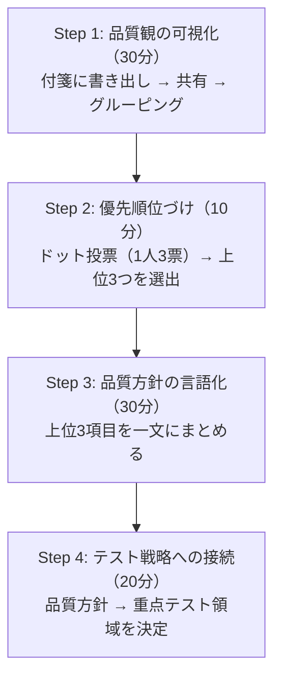

:::message
この章のポイント: 「うちのプロダクトの品質って何？」をチームで合意する品質定義ワークショップ。90分で品質方針が決まる。
:::

## 4-1. なぜ品質の定義が必要なのか


リリース判定会議で、こんなやり取りが起きたことはないだろうか。

PM「UIがわかりにくいから延期しましょう」。

開発「バグ0件なんだから出せるでしょう」。

QA「テストケース全Passです。品質は高いです」。

3人とも「品質」の話をしている。3人とも間違っていない。しかし3人が話している「品質」は全部違う。PMは使いやすさの話をしている。開発はコードの正しさの話をしている。QAはテスト結果の話をしている。

「品質を上げよう」。この一言で全員が同じものを思い浮かべるチームは、ほぼ存在しない。

品質の定義がないまま品質保証活動を始めると、何のための活動かが揃わない。[第3章](/books/testing-not-equals-qa/chapter3_1)で14のQA活動をカタログにした。しかし、14の活動を「何のために」やるのか。ゴールが揃っていなければ、活動の方向がバラバラになる。

テスト戦略を立てるにも、「何の品質を守るか」が前提だ。前提が揃っていなければ、テストの終了条件も決められない。「品質が十分か」を判断するには「十分とは何か」の定義が先に要る。

この章では、チームで品質を定義するワークショップを実践する。90分で「うちのプロダクトにとって品質とは何か」を言語化する方法だ。


### 品質定義と3章の活動カタログの関係


[第3章](/books/testing-not-equals-qa/chapter3_1)でQA活動のカタログを整理した。14の活動を知ることで「テスト以外にもやれることがある」とわかった。しかし、14の活動のうちどれを優先すべきか。「全部やろう」は非現実的だし、「できそうなものからやろう」では戦略がない。

品質の定義が先にあれば、14の活動に優先順位がつく。

例えば品質方針が「決済の正確性」なら、リスク分析（活動3）とテスタビリティ設計（活動2）の優先度が高い。品質方針が「障害からの復旧力」なら、バグ分析（活動10）とメトリクス設計（活動11）の優先度が高い。

品質を定義する → 品質方針に沿ってQA活動を選ぶ → テスト戦略に落とし込む。品質定義（本章）で方針を決め、[第3章](/books/testing-not-equals-qa/chapter3_1)のカタログから活動を選び、[第5章](/books/testing-not-equals-qa/chapter5_1)でテスト戦略に落とし込む。これが本書の接続だ。


### 品質の定義がないチームの4つの症状


自分のチームに品質の定義があるかどうか、4つの症状でチェックできる。

**症状1: リリース判定が紛糾する**。品質の基準が揃っていないから、毎回「出す/出さない」で揉める。会議の時間だけが長くなる。

**症状2: テストの終了条件を誰も説明できない**。「いつテストが終わるんですか？」と聞かれて「全ケースPassしたら」としか答えられない。品質方針がないから、テストの終了条件が「全部通ること」以外に表現できない。

**症状3: 品質改善の施策が長続きしない**。「コードレビューを強化しよう」「カバレッジを上げよう」。施策は出るが、3ヶ月後には消えている。施策が「品質方針のこの項目を改善するため」と紐づいていないから、優先度が下がると自然消滅する。

**症状4: 品質の話が「バグの数」に収束する**。品質の定義がないと、唯一の共通言語が「バグの数」になる。バグが少なければ品質が高い、バグが多ければ品質が低い。[第2章](/books/testing-not-equals-qa/chapter2)の負債3（テスト工数＝品質投資）と同じ罠だ。


### 品質定義がないことのコスト


症状を見て「うちもそうだ」と思ったなら、品質定義がないことに毎月どのくらいのコストがかかっているか、ざっくり計算してみよう。

| コスト項目 | 計算方法 | 典型的な数値 |
|---|---|---|
| リリース判定の紛糾 | 会議時間 × 参加者数 × 時間単価 × 回数/月 | 60分 × 6人 × 5千円 × 4回 = 12万円/月 |
| 「念のため」テスト | 不要なテスト工数 × 時間単価 | 20時間 × 5千円 = 10万円/月 |
| 手戻り（品質基準の認識違い） | 手戻り工数 × 時間単価 | 30時間 × 5千円 = 15万円/月 |
| 品質に関する非同期議論 | 社内チャットツールの品質議論に費やす時間 | 1日30分 × 20日 × 3人 × 5千円 = 15万円/月 |


合計すると月52万円、年間624万円。人件費1人分に近い。

もちろんこれは仮定の数字で、チームの状況によって大きく変わる。しかし「品質の定義がないことのコスト」を意識している人は少ない。90分のワークショップで品質方針を作れば、このコストの一部は削減の糸口がつかめる。ただし定着させるには4-5で扱う運用レベルまで育てる必要がある。

この計算を経営層への説得材料として使うのも有効だ。「品質方針のワークショップに90分ください」より「月52万円のコスト削減のために90分ください」の方が通りやすい。


## 4-2. ワークショップ Step 1: 品質観の可視化


ワークショップの最初のステップ。参加者全員が「このプロダクトで大事な品質は何か」を書き出す。


### 準備


- 参加者: PM、開発、QA、デザイナーから各1名以上。3〜8人が適正
- 準備物: 付箋（1人5枚以上）、マーカー、ホワイトボード
- 所要時間: この Step だけで30分


### やり方


ファシリテーターが冒頭に宣言する。「正解はありません。自分の言葉で書いてください」。

この宣言が重要だ。「正解がある」と思うと、参加者は正しそうな答えを探し始める。品質特性の教科書的な用語を並べるだけになる。自分の言葉で書いてもらわないと、本音の品質観が出てこない。

**書き出しフェーズ（10分）**: 各自が付箋に「このプロダクトで大事だと思う品質」を書く。1枚に1つ。最低3枚。声の大きい人が先に発言すると、他の人が引っ張られる。だから全員が書き終わるまで共有しない。

出てくる付箋の例:
- 「決済が正確に動くこと」
- 「画面の表示が速いこと」
- 「初めてのユーザーが迷わないこと」
- 「障害が起きてもすぐ復旧できること」
- 「新機能を安全に追加できること」

**共有フェーズ（15分）**: 順番に1枚ずつホワイトボードに貼って説明する。説明は30秒以内。貼り終わったら、似ているものを近くに寄せてグルーピングする。

グルーピングが済んだら、5〜8つのグループに名前をつける。「使いやすさ」「速さ」「正確さ」「安全性」「復旧力」「保守のしやすさ」。こんな感じで、チームの言葉でラベルをつける。


### グルーピングの実況


実際のワークショップでは、こんなやり取りが起きる。

PM「『初めてのユーザーが迷わない』と『ヘルプを見なくても操作できる』は近いですね。『使いやすさ』でまとめましょうか」

開発「『新機能を安全に追加できる』と『バグ修正が他の機能を壊さない』は同じグループですかね。『変えやすさ』？」

QA「『障害が起きてもすぐ復旧できる』と『データが消えない』は近いけど違う気もします」

ファシリテーター「分けるか迷ったら、分けておきましょう。後から統合はできますが、先に統合すると情報が消えます」

このやり取りで注目してほしいのは、チームが自分たちの言葉でラベルをつけていること。「信頼性」ではなく「復旧力」。「保守性」ではなく「変えやすさ」。ISO 25010の正式名称を使う必要はない。自分たちが日常的に使う言葉の方が、方針として定着する。


### よくある落とし穴


**落とし穴1: 機能要件が混ざる**。「ログイン機能がある」「検索ができる」は機能要件であって品質ではない。「ログインが2秒以内に完了する」「検索結果が正確に返る」なら品質だ。機能の「ある/なし」ではなく、機能の「良し悪し」に注目してもらう。

**落とし穴2: ネガティブ表現に偏る**。「バグがない」「落ちない」「遅くない」。否定形ばかりだと、目標が「ゼロにする」しかなくなる。「速い」「正確」「使いやすい」のようにポジティブに言い換えると、達成基準が設定しやすい。

**落とし穴3: 1人が大量に書く**。品質に詳しい人ほど大量に書く。それ自体は悪くないが、1人の意見に偏ると「チームの品質観」にならない。書く枚数の上限は設けなくていいが、共有時には1人1枚ずつ順番に出す。


### ISO 25010ヒントカード


Step 1の残り時間で行うオプションのステップだ。付箋の書き出しとグルーピングが早く終わったら、残り時間で取り組む。時間が足りなければ省略しても問題ない。

付箋が出尽くしたあとに、ISO 25010の品質特性カードを配布する。先に見せてはいけない。先に見せると「用語を選ぶ」だけになり、自分の言葉で考えなくなる。


:::message
**ISO 25010（ISO/IEC 25010:2023）とは**
ソフトウェアの品質を8つの特性に分類した国際標準。機能適合性、性能効率性、互換性、使用性、信頼性、セキュリティ、保守性、移植性の8つ。品質について議論するときの共通言語として使える。ただし、これは品質の「分類」であって「定義」ではない。自分たちのプロダクトにとって何が大事かは、自分たちで決める必要がある。
:::


ISO 25010の8つの品質特性は以下の通り。ヒントカードにはこの表を簡略化して使う。

| # | 品質特性 | 一言で言うと | 身近な例 |
|---|---|---|---|
| 1 | 機能適合性 | やるべきことをやるか | 計算結果が正しい、検索結果が正確 |
| 2 | 性能効率性 | 速いか、軽いか | ページが2秒以内に表示される |
| 3 | 互換性 | 他と一緒に動くか | 異なるブラウザ、異なるOSで動く |
| 4 | 使用性 | 使いやすいか | 初めてのユーザーが迷わない |
| 5 | 信頼性 | 壊れないか、壊れても戻るか | 24時間365日稼働、障害時に自動復旧 |
| 6 | セキュリティ | 守られているか | 不正アクセスを防ぐ、データが暗号化 |
| 7 | 保守性 | 直しやすいか、変えやすいか | バグ修正が簡単、新機能追加が安全 |
| 8 | 移植性 | 別の環境に持っていけるか | オンプレからクラウドへの移行 |


ここで重要なポイント。8つの特性は「全部大事」だが「全部を同じレベルで追求はできない」。ラーメン屋の品質と同じだ（後述のたとえ話を参照）。

カードを配布したら「自分たちが出した付箋の中に、この8つのうち抜けているものはないか」を確認する。特に抜けやすいのは「保守性」と「信頼性」だ。開発者以外のメンバーは保守性を意識しにくいし、信頼性は「壊れたことがないから大丈夫」と過信されがちだ。

抜けに気づいたら追加する。ただし、全8特性を無理に追加する必要はない。自分たちのプロダクトで本当に重要な特性だけを残す。「互換性」がほとんど関係ないプロダクトもある。「移植性」が今のフェーズでは不要なプロダクトもある。

**ヒントカード配布後によくある気づき**

| 抜けていた特性 | よくある理由 | 典型的な追加の付箋 |
|---|---|---|
| 保守性 | 開発者以外は「コードの中身」に関心が薄い | 「バグ修正が他の機能を壊さない」「新機能を安全に追加できる」 |
| 信頼性 | 「まだ大きな障害を経験していない」 | 「障害時に自動で復旧する」「データが消えない」 |
| セキュリティ | 「セキュリティは別チームの仕事」と思い込んでいる | 「ユーザーデータが漏洩しない」「不正アクセスを防ぐ」 |
| 性能効率性 | 機能の正しさに意識が集中している | 「画面が2秒以内に表示される」「大量データでも遅くならない」 |


ヒントカードを見て「全部追加したい」という反応が出ることがある。それは自然な反応だ。しかし、次のStep 2（優先順位づけ）で絞り込むので、この段階では追加を恐れなくていい。

この Step の成果物は「付箋20〜40枚が5〜8グループに分類された品質観の一覧」だ。


## 4-3. ワークショップ Step 2: 優先順位づけ


品質観を可視化したら、次は優先順位をつける。


### 問い


優先順位をつけるときの問いが重要だ。「大事なものはどれ？」と聞いてはいけない。全部大事だから。

聞くべきは「壊れたら最も困るものはどれ？」だ。

「大事なもの」と「壊れたら困るもの」は似ているが違う。「使いやすさは大事」は全員が同意する。しかし「使いやすさが壊れることと、決済が壊れること、どちらが困るか」と聞けば、優先順位が明確になる。

これはリスクベースの発想だ。[第3章](/books/testing-not-equals-qa/chapter3_1)のリスク分析と同じ構造。「壊れたときの影響度」で優先順位をつける。


### ドット投票


ドット投票で1人3票。5〜8のグループの中から、壊れたら最も困るものに投票する。1つのグループに複数票入れてもいい。

投票結果を集計すると、チームの品質観が数字で見える。


### 投票結果の例: ECサイトの場合


6人のチーム（PM1名、開発3名、QA1名、デザイナー1名）で実施した場合の結果。

| グループ | PM | 開発A | 開発B | 開発C | QA | デザイナー | 計 |
|---|---|---|---|---|---|---|---|
| 正確さ（決済・在庫） | ●●● | ●● | ● | ●● | ●● |  | 10 |
| 速さ（表示速度） |  | ● | ● |  |  | ● | 3 |
| 使いやすさ |  |  |  |  |  | ●● | 2 |
| 安全性（セキュリティ） |  |  | ● | ● | ● |  | 3 |
| 変えやすさ（保守性） |  |  |  |  |  |  | 0 |
| 復旧力（障害対応） |  |  |  |  |  |  | 0 |


結果は明快だ。「正確さ」が圧倒的トップ。ECサイトで決済や在庫が壊れたら致命的、という共通認識がある。「速さ」と「安全性」が同率2位。「使いやすさ」はデザイナーだけが投票。「変えやすさ」と「復旧力」はゼロ。


### 投票結果を読み解く


投票結果で注目すべきは3つ。

**1. 集中**: 1つのグループに票が集中した場合、チーム内で品質観が揃っている。迷わず品質方針のトップに据える。

**2. 分散**: 票がバラけた場合、チーム内で品質観が揃っていない。これは悪いことではない。揃っていないことが見えたのが収穫。

**3. ゼロ票**: 誰も投票しなかったグループ。「保守性」や「移植性」がゼロ票になりがちだ。ゼロ票＝不要、ではない。「壊れても今すぐは困らないが、半年後に困る」品質かもしれない。ゼロ票のグループについて「本当に不要か、それとも将来困るか」を5分だけ議論する。


### 対立を活かす


PMと開発で投票が割れることがある。PMが「使いやすさ」に集中投票し、開発が「保守性」に集中投票する。割れたこと自体が発見だ。「ここが揃っていなかったから、品質の話が噛み合わなかったのか」という気づきが生まれる。

よくある対立パターン:

| 対立パターン | PM側 | 開発側 | 背景 |
|---|---|---|---|
| ユーザー体験 vs 技術品質 | 使いやすさ | 保守性 | PMはユーザーを見る、開発はコードを見る |
| 今の品質 vs 将来の品質 | 正確さ | 変えやすさ | PMは今のリリースを見る、開発は半年後を見る |
| 外部品質 vs 内部品質 | 速さ | セキュリティ | PMは目に見える品質を見る、開発は見えない品質を見る |


対立は悪いことではない。対立が見えたことが収穫だ。見えない対立が一番危ない。品質の話が噛み合わない原因がわからないまま、「品質を上げよう」と空回りし続けることになる。

投票の結果、上位3つが「このプロダクトで守るべき品質」の候補になる。


## 4-4. ワークショップ Step 3: 合意形成


上位3つを「品質方針」として明文化する。


### 明文化のポイント


抽象的すぎてもダメ。具体的すぎてもダメ。

| レベル | 例 | 判定 |
|---|---|---|
| 抽象的すぎる | 「品質を大事にする」 | ✗ 何も言っていない |
| やや抽象 | 「使いやすくする」 | △ 方向は見えるが基準がない |
| ちょうどいい | 「初回ユーザーが登録完了までに迷わない」 | ○ テスト可能 |
| 具体的すぎる | 「ボタンの色は#FF6600にする」 | ✗ 品質方針ではなく仕様 |


「ちょうどいい」のレベルは「テストの終了条件を決められるか」で判断する。文言を見て「この品質が満たされているかどうか、どうやって確認する？」と聞いたときに、確認方法が思い浮かぶ粒度がちょうどいい。


### 明文化の実況


実際のワークショップでは、こんな会話が起きる。

PM「投票結果のトップは『正確さ』ですね。これを品質方針にすると......『データが正確であること』？」

ファシリ「この方針で、テストの終了条件を決められますか？」

QA「ちょっと広すぎます。『データが正確』だと何をテストすればいいかわからない。決済のデータなのか、ユーザー情報なのか」

開発「決済に絞りませんか？ 投票の付箋にも『決済が正確に動く』が一番多かった」

PM「たしかに。『決済処理がすべてのケースで正しく完了する』。これならテストの終了条件が決められそうです」

ファシリ「いいですね。次、2位の『信頼性』。どう明文化しましょう？」

このように、「テストの終了条件を決められるか」を合言葉にして、具体度を調整していく。


### 合意の確認


文言ができたら、全員に確認する。「この3つの方針で、テストの終了条件を決められそうですか？」。全員がYesと言えたら合意成立。

ここで重要なのは「全会一致」ではなく「全員が許容できる」こと。100%同意でなくても、「この方針に沿って進めるのは構わない」であれば合意成立だ。完璧な合意を目指すと、方針が抽象的になりすぎるか、延々と議論が続く。

**投票結果の「意外なギャップ」に注目する**

投票の結果、PMと開発者で優先順位が大きく異なることがよくある。

| よくあるギャップ | PM | 開発 | QA |
|---|---|---|---|
| 使いやすさ vs 保守性 | 使いやすさを重視 | 保守性を重視 | どちらも均等 |
| 速さ vs 正確性 | 速さを重視（UX） | 正確性を重視（バグ防止） | 正確性を重視 |
| セキュリティ vs 機能追加速度 | 機能追加を重視 | セキュリティを重視 | セキュリティを重視 |


このギャップ自体が発見だ。「自分たちは品質の何を大事にしているか」の認識がチーム内でずれていることを可視化できる。ギャップを見つけたら「なぜそう思うか」を30秒ずつ話してもらう。相手の視点を知ること自体に価値がある。

品質方針は、チームの壁に貼る。社内チャットツールのチャンネルに固定する。常に見える場所に置く。見えない品質方針は存在しないのと同じだ。


### 品質方針の形式


品質方針の書き方にはいくつかの形式がある。

| 形式 | 例 | 向いているチーム |
|---|---|---|
| 箇条書き3行 | 「決済が正確」「5分で復旧」「初回登録3分」 | 全チーム。まずはこの形式で十分 |
| マニフェスト型 | 「私たちは〜を約束する」形式 | 文化として根づかせたいチーム |
| 指標付き | 方針＋目標値＋測定方法のセット | 成熟度の高いチーム |
| カード型 | 1方針1カードで壁に貼る | 大人数チーム。物理的に見える化 |


最初は「箇条書き3行」で十分だ。品質方針は「運用されること」が最も大事で、形式の美しさは二の次。

品質方針の例:

1. **正確性**: 決済処理がすべてのケースで正しく完了する
1. **信頼性**: 障害が起きても5分以内に復旧できる
1. **使用性**: 初回ユーザーが登録を3分以内に完了できる


### 業界・プロダクト別の品質方針例


品質方針は業界やプロダクトの特性で大きく変わる。以下の例を参考にしつつ、自分たちのプロダクトに合わせてカスタマイズしてほしい。

**ECサイトの場合**

| 優先度 | 品質方針 | 背景 |
|---|---|---|
| 1 | 決済処理が全パターンで正確に完了する | 金銭が絡む。誤課金は信用毀損 |
| 2 | 商品情報の表示速度が2秒以内 | 表示が遅いと離脱率が上がる |
| 3 | 不正アクセスからユーザーデータを保護する | 個人情報・カード情報の漏洩防止 |


**BtoBのSaaSの場合**

| 優先度 | 品質方針 | 背景 |
|---|---|---|
| 1 | 稼働率99.9%を維持する | SLA契約がある。ダウンは違約金 |
| 2 | データの整合性を常に保証する | 顧客の業務データが消えたら致命的 |
| 3 | 主要ブラウザ最新2バージョンで正常動作 | 顧客企業のIT環境が多様 |


**IoTデバイス連携の場合**

| 優先度 | 品質方針 | 背景 |
|---|---|---|
| 1 | デバイスの操作が3秒以内に応答する | 物理空間の体験。待たされるとストレス |
| 2 | OTA更新後もデバイスが正常動作する | 文鎮化したら物理的に回収が必要 |
| 3 | オフライン時でも基本機能が動作する | 通信障害でも使えなくなっては困る |


品質方針の数は3つが基本だ。多くても5つまで。「全部大事」を方針に書いたら、何も書いていないのと同じだ。


### 品質方針のアンチパターン


ワークショップの結果を品質方針にまとめるとき、よくある失敗パターンを紹介する。

**アンチパターン1: 願望リスト型**

```
品質方針:
- バグがないこと
- 速いこと
- 使いやすいこと
- 安全なこと
- 壊れないこと
- 直しやすいこと
```


全部書いている＝何も書いていない。「壊れたら最も困るもの」で絞り込む覚悟がない。方針が多すぎると、結局どれも中途半端に守ることになる。

**アンチパターン2: 誰が書いても同じ型**

```
品質方針:
- 高品質なプロダクトを提供する
- ユーザーに信頼されるサービスを目指す
- 継続的な品質改善を行う
```


どのプロダクトにも当てはまる。つまり、自分たちのプロダクトに固有の品質が何も書かれていない。「うちのラーメン屋は美味しいラーメンを作ります」と言っているのと同じだ。

**アンチパターン3: 数値だけ型**

```
品質方針:
- バグ密度0.5件/KLOC以下
- テストカバレッジ80%以上
- MTTR 5分以下
```


数値は目標であって方針ではない。「なぜMTTR 5分なのか」「どの品質を守るためにカバレッジ80%なのか」が欠けている。品質方針→目標値の順番が逆になっている。

**アンチパターン4: QA部門だけの方針型**

```
品質方針（QA部門）:
- テスト工程でバグを100%検出する
- テストケースの網羅率を高める
```


品質方針はQA部門のものではない。プロダクトチーム全体のものだ。QA部門だけで品質方針を作ると、「品質＝テスト」の罠に戻ってしまう。ワークショップにPM・開発・デザイナーを呼ぶのはこのためだ。


## 4-5. ワークショップ Step 4: 目標への落とし込み


品質方針を測定可能な目標に変換する。


### 変換の方法


品質方針1つにつき、2〜3つの測定可能な目標を設定する。

| 品質方針 | 目標（測定方法） |
|---|---|
| 決済処理がすべて正しく完了する | 決済エラー率0.01%以下（ログ監視） |
| 障害から5分以内に復旧できる | MTTR 5分以下（障害対応記録） |
| 初回ユーザーが3分以内に登録完了 | タスク完了率95%以上（ユーザビリティテスト） |


:::message
**MTTR（Mean Time To Recovery）とは**
障害が発生してから復旧するまでの平均時間。「壊れたらどのくらいで直せるか」の指標。MTTRが短いほど、障害に強い組織と言える。
:::


### テスト終了条件への組み込み


品質方針ごとに「この品質が満たされていると判断できる条件」を書く。これがテスト戦略の起点になる。

| 品質方針 | テスト終了条件 |
|---|---|
| 決済の正確性 | 決済パターン全網羅テストPass。異常系テスト全件Pass |
| 障害復旧力 | フェイルオーバーテストでMTTR 5分以内を確認 |
| 初回ユーザビリティ | 登録フローのE2Eテスト全件Pass。UIレビュー完了 |


ここまで来ると、「テストが十分か」の判断に根拠が生まれる。テストケースの件数ではなく、品質方針に対する充足度でテストの十分性を判断できる。


### Before/After: 品質方針があるリリース判定


品質方針がない場合と、ある場合で、リリース判定がどう変わるか。

**Before（品質方針なし）**

PM「テスト状況はどうですか？」
QA「300件中298件Passです。残り2件は明日中に消化します」
PM「バグはどうですか？」
QA「重大バグ0件、軽微なバグ3件です」
PM「......品質は大丈夫ですかね？」
開発「大丈夫だと思いますけど......」
PM「じゃあ出しましょうか。いや、やっぱりもう1日待ちましょうか」

（結論が出ないまま30分経過）

**After（品質方針あり）**

PM「品質方針の3項目、達成状況を確認します」
QA「方針1: 決済の正確性。決済パターン全網羅テスト38件Pass、異常系テスト12件Pass。達成」
QA「方針2: 障害復旧力。フェイルオーバーテスト実施済、MTTR 3分42秒。達成」
QA「方針3: 初回ユーザビリティ。登録フローE2E 15件Pass。UIレビュー完了。達成」
PM「3項目すべて達成。リリースします」

（5分で完了）

差は明確だ。品質方針がないと「大丈夫だと思う」で判断する。品質方針があると「達成基準を満たしている」で判断する。感覚が根拠に変わる。


### 目標設定の落とし穴


品質目標を設定するときに陥りやすい罠がある。

**罠1: 最初から完璧な数値を求める**。「決済エラー率0.01%以下」と決めたものの、そもそも今のエラー率を計測していなかった。目標を決める前に、まず現状を測る。現状がわからなければ「3ヶ月間計測して、ベースラインを確定する」が最初の目標になる。

**罠2: 測定コストが高すぎる**。「ユーザビリティテストで全タスク完了率95%以上」は良い目標だが、毎スプリントでユーザビリティテストを実施するのは現実的でない。目標は「達成できるか」だけでなく「測定し続けられるか」も考慮する。

**罠3: 目標だけあって行動がない**。「MTTR 5分以下」を目標にしたが、復旧訓練もしていないし、復旧手順書も作っていない。目標は行動を変えるためにある。目標ごとに「この目標を達成するために何をするか」のアクションリストを1つは作る。


### フェーズ別の品質目標


プロダクトの成長フェーズによって、品質目標のレベルを段階的に上げていく。

| フェーズ | 品質の焦点 | 目標の粒度 | 計測方法 |
|---|---|---|---|
| MVP（検証段階） | 動くこと | 致命的バグ0件 | 手動テスト |
| PMF後（成長段階） | 壊れないこと | MTTR、エラー率 | ログ監視 |
| スケール段階 | 速いこと、安全なこと | レイテンシ、セキュリティ | APM、脆弱性スキャン |
| 成熟段階 | 変えやすいこと | デプロイ頻度、変更失敗率 | CI/CDメトリクス |


MVP段階で「デプロイ頻度を上げよう」は時期尚早だ。スケール段階で「動くかどうか」を心配しているなら、前のフェーズの品質が足りていない。


### 見直しのタイミング


品質方針は一度決めたら終わりではない。以下のタイミングで見直す。

- **定期**: 四半期に1回
- **イベント駆動**: 大きな障害が起きたとき。プロダクトの方針が変わったとき。チーム構成が大きく変わったとき

プロダクトは成長する。成長のフェーズが変われば、守るべき品質も変わる。ローンチ直後は「動くこと」が最優先かもしれない。ユーザーが増えてきたら「壊れないこと」「速いこと」が重要になる。品質方針はプロダクトと一緒に育てるものだ。


### 段階的な導入ロードマップ


「いきなり90分のワークショップは難しい」というチームのために、段階的な導入方法を提示する。

**レベル1: 品質の会話を始める（今日から）**。次のミーティングで「うちのプロダクトで壊れたら一番困るものって何ですか？」と聞く。5分の雑談でいい。チームメンバーの品質観を知ることが第一歩。

**レベル2: 品質方針のドラフトを作る（1週間以内）**。本章のワークを1人でやる。15分。結果を社内チャットツールに投稿して「みなさんはどう思いますか？」と聞く。非同期でも品質観の議論は始められる。

**レベル3: ワークショップを実施する（1ヶ月以内）**。本章のファシリテーションガイドに従って90分のワークショップを開催する。品質方針を合意して、社内チャットツールに固定する。

**レベル4: 品質方針をテスト戦略に組み込む（3ヶ月以内）**。品質方針に基づいてテスト終了条件を設定する。リリース判定で品質方針を使う。[第5章](/books/testing-not-equals-qa/chapter5_1)のテスト戦略テンプレートに品質方針を記入する。

**レベル5: 品質方針の見直しサイクルを回す（四半期ごと）**。四半期末に品質方針を見直す。プロダクトの変化に合わせて方針を更新する。更新のたびにテスト戦略も更新する。

レベル1だけでも、昨日より品質への解像度が上がる。全部やらなくていい。できるところから始める。


### 品質方針の日常運用チェックリスト


品質方針を作った後の運用で確認すべき項目をまとめる。

**週次**
- リリース判定で品質方針の3項目を参照したか
- 新しいバグが品質方針のどの項目に影響するか確認したか

**月次**
- 品質方針の達成状況を1行で記録したか
- テスト設計のレビューで品質方針を参照したか

**四半期**
- 品質方針の見直しミーティングを実施したか
- プロダクトの方針変更があった場合、品質方針も更新したか
- テスト戦略が品質方針と整合しているか確認したか

週次の確認は「習慣化」が目的だ。月次は「定着の確認」。四半期は「進化」。この3段階で品質方針が生き続ける。


### 品質方針が文化になるとき


ある程度チームに品質方針が浸透すると、品質方針を意識しなくても自然に品質を守れるようになる。品質方針が「当たり前」になった状態だ。

これは品質方針を捨てていい合図ではない。品質方針が文化になった状態だ。文化になっても品質方針はドキュメントとして残す。新しいメンバーが入ったとき、チームの品質観を伝える最速の手段になる。運用の負荷は軽くする。見直しの頻度を四半期から半期にする、くらいの調整で十分だ。


### ワークショップ全体の流れ


4つのステップを図にまとめる。


**ワークショップ全体の流れ**




残りの15分は余白だ。議論が盛り上がったところに使う。


### 品質定義から次章への橋渡し


この章で「うちの品質」が定義できた。次に必要なのは、定義した品質を「どう守るか」だ。

| この章で決めたこと | 次章で決めること |
|---|---|
| 何の品質を守るか（品質方針） | どう守るか（テスト戦略） |
| 品質の優先順位 | テストの優先順位 |
| 測定可能な目標 | テスト終了条件 |
| 見直しのタイミング | テスト戦略の更新タイミング |


品質方針→テスト戦略→テスト設計→テスト実行。上流の成果物が下流の入力になる一本の流れだ。この流れを具体化するのが[第5章](/books/testing-not-equals-qa/chapter5_1)のテーマだ。

品質の定義が揃ったら、いよいよテスト戦略とテスト設計だ。[第5章](/books/testing-not-equals-qa/chapter5_1)では、定義した品質を守るための戦略をどう立てるか、テスト設計をどう武器にするかを実践する。


## 用語解説


:::message
**品質特性（Quality Characteristics）**
ソフトウェアの品質を分類する軸のこと。ISO 25010では8つの特性を定義している。品質について議論するときの共通言語として使えるが、分類であって定義ではない。「うちのプロダクトで何が大事か」は、チームが自分たちで決めるものだ。
:::


:::message
**非機能要件（Non-functional Requirements）**
機能以外の品質に関する要件。「ログインできる」は機能要件。「ログイン画面が2秒以内に表示される」は非機能要件。性能、セキュリティ、可用性、保守性などが含まれる。機能要件だけで品質を語ると、非機能の品質が見落とされやすい。
:::


:::message
**SLA（Service Level Agreement）**
サービス品質の保証水準を定めた合意。「月間稼働率99.9%を保証する」のような契約上の約束。これを下回ると契約違反になる。外部に対する約束。
:::


:::message
**SLO（Service Level Objective）**
SLAを達成するための内部目標値。SLAが99.9%なら、SLOは99.95%に設定するのが一般的。SLAより厳しい基準を内部で持つことで、SLA違反を未然に防ぐ。
:::


:::message
**ドット投票**
参加者全員にシール（ドット）を配り、選択肢に貼って投票する方法。1人3〜5票が一般的。議論だけでは声の大きい人に引っ張られがちだが、投票なら全員の意見が同じ重みで反映される。品質方針の優先順位づけだけでなく、ふりかえりの改善項目選定など、合意形成の場で広く使える。
:::


:::message
**品質方針（Quality Policy）**
プロダクトやチームが「守るべき品質」を言語化したもの。品質の憲法のようなもので、テスト戦略の前提になる。品質方針がない状態は「何を守るかが決まっていないのにテストをしている」ことになる。ISO 9001でも品質方針の策定は要求事項だが、本書では国際標準の形式にこだわらず、チームの言葉で書くことを推奨する。
:::


:::message
**テスト終了条件（Exit Criteria）**
「テストをここまでやったら完了」とする基準。品質方針がないと「全件Pass」以外の基準が設定できず、テストがいつまでも終わらないか、早すぎる打ち切りが起きる。品質方針に基づいてテスト終了条件を設定すると「なぜこのテストで十分か」を説明できるようになる。
:::


:::message
**ガードレール（品質文脈）**
「このラインを下回ってはならない」という制約条件。品質方針はガードレールとして機能する。高速道路のガードレールが「落ちないための最低限の安全装置」であるのと同じで、品質方針は「品質が崩壊しないための最低限の基準」。超えるべき目標（OKR）とは役割が違う。
:::


:::message
**ISO 25010**
ソフトウェア品質特性の国際標準（正式名: ISO/IEC 25010:2023 Systems and software Quality Requirements and Evaluation）。品質を8つの特性（機能適合性、性能効率性、互換性、使用性、信頼性、セキュリティ、保守性、移植性）に分類する。品質方針を作るときのチェックリストとして使えるが、8特性すべてを方針に入れる必要はない。自分たちのプロダクトに重要な特性を選ぶ。
:::


:::message
**PMF（Product Market Fit）**
プロダクトが市場のニーズに合致している状態。PMF前は「機能が正しく動くこと」が最優先の品質。PMF後は「安定して動き続けること」「速いこと」に品質の重点が移る。プロダクトの成長フェーズによって品質方針を見直す根拠の1つ。
:::


:::message
**品質コスト（Cost of Quality / COQ）**
品質に関わるコストの総称。大きく「適合コスト」と「不適合コスト」に分かれる。適合コストは品質を確保するためのコスト（テスト、レビュー、プロセス改善）。不適合コストは品質不良によるコスト（バグ修正、障害対応、ユーザー離脱、信頼低下）。「テストにコストをかけすぎ」と言われたときに、不適合コストと比較して説明すると議論が前に進む。一般的に、予防に1かけると手戻りの10を防げると言われている。
:::


:::message
**ファシリテーション**
参加者全員が発言しやすい場をつくり、議論を整理して合意形成を導く技術。品質定義ワークショップではファシリテーターの役割が重要だ。ファシリテーターは「自分の意見を通す人」ではなく「全員の意見を引き出す人」。品質方針の議論では、声の大きい人の意見だけが通ると、チーム全体の合意にならない。ドット投票やタイムボックスなどの仕組みで「全員が同じ重みで参加できる場」を作ることがファシリテーターの仕事だ。
:::


:::message
**エラーバジェット（Error Budget）**
SLO（サービスレベル目標）を100%から引いた「許容できる失敗の量」。SLOが99.9%なら、エラーバジェットは0.1%＝月間約43分のダウンタイム。エラーバジェットが残っているうちは新機能のリリースを積極的に行い、バジェットを使い切ったら信頼性改善に集中する。品質と開発速度のバランスを数字で管理する仕組み。SREの考え方だが、品質方針を「どこまで許容するか」の視点で定義する際に参考になる。
:::


## ラーメン屋のたとえ


品質って何？と聞かれて、すぐ答えられる人は少ない。もう少し身近なもので考えてみよう。

ラーメン屋の「品質が高い」とは何だろう。

- 味がうまい？
- 提供が速い？
- 店が清潔？
- 量が多い？
- 値段が安い？

全部「品質」だ。しかし、全部を同時に最高にはできない。

二郎系ラーメンと一蘭では「品質が高い」の意味がまったく違う。二郎系は量と力強さが品質。一蘭は味へのこだわりと食体験が品質。どちらも行列ができるほど高品質だが、中身がまるで違う。

二郎系に行って「量が少ない。品質が低い」と言う人はいない。一蘭に行って「仕切りがあって寂しい。品質が低い」と言う人もいない。それぞれの店が定義した品質に対して、客は評価している。

ソフトウェアも同じだ。「品質が高い」の意味はプロダクトによって違う。ECサイトなら決済の正確性。ゲームならレスポンスの速さ。医療システムならデータの整合性。プロダクトが変われば、守るべき品質が変わる。

だから定義が必要だ。「うちのラーメン屋は何で勝負するか」を決めないと、味も量も速さも中途半端なラーメン屋になる。

ソフトウェアに戻ろう。このたとえで何が言いたいか。

| ラーメン屋 | ソフトウェア | ポイント |
|---|---|---|
| 味で勝負する | 機能の正確性で勝負する | 何を「うちの品質」にするか |
| 二郎系と一蘭は品質の意味が違う | ECサイトとゲームは品質の意味が違う | 品質は相対的 |
| メニューを決めないと仕入れが定まらない | 品質方針がないとテスト戦略が定まらない | 定義が先、活動が後 |
| 客がリピートする理由が「品質」 | ユーザーが信頼する理由が「品質」 | 品質の定義＝信頼の定義 |


ラーメン屋の「品質が高い」は「うちのこだわりに対して、ブレていない」ということ。ソフトウェアも同じ。品質方針に対してブレていなければ、そのプロダクトの品質は高い。


## コラム：品質定義なしで半年走った結果


あるあるな話。

あるチームが新規プロダクトの開発を始めた。品質の定義はない。「まずは動くものを作ろう」。全員がそう思っていた。

最初の3ヶ月は問題なかった。小さいチームで全員が同じ方向を見ていたから。リリースのたびに「いい感じだね」で済んでいた。

4ヶ月目、チームが倍になった。新しいメンバーは前提を共有していない。ある人は「パフォーマンスが最優先」、ある人は「機能の網羅性が品質」、ある人は「バグ0件が品質」。誰も間違っていないが、全員違うものを追いかけている。

5ヶ月目、リリース判定が紛糾し始めた。「品質は十分か」の質問に、毎回違う答えが返ってくる。会議が長引く。結局、声が大きい人の判断で出す。出した後に問題が起きると「品質チェックが甘かった」と言われる。

6ヶ月目、QAエンジニアが退職届を出した。理由は「何をどこまでやれば十分なのかわからない。毎回ゴールが動く」。

品質方針が1枚あれば、この6ヶ月は違っていた。「十分とは何か」が定義されていれば、ゴールは動かない。


## コラム：品質方針を作ったら開発が速くなった話


あるあるな話。

あるチームが品質方針を作った。きっかけはリリース判定会議の長さだ。毎回60分かかっていた。

品質方針は3つ。「決済が正しい」「表示が速い」「セキュリティが守られている」。

品質方針ができた翌週から、リリース判定が変わった。「品質方針の3項目、それぞれの達成状況を報告してください」。報告は10分で終わる。判定は5分。合計15分。45分短くなった。

しかし、想定外の効果がもう1つあった。開発が速くなった。

なぜか。品質方針ができる前、開発チームは「テストが足りないかもしれない」という不安を常に抱えていた。不安だから、念のためテストを追加する。念のため手動で確認する。念のためレビューを増やす。この「念のため」が積み重なって、開発速度を落としていた。

品質方針ができたことで「ここまでやれば大丈夫」のラインが見えた。品質方針の3項目を満たしていれば、それ以上の「念のため」は不要だとわかった。テストの量が減ったのではない。不要なテストが減り、必要なテストに集中できるようになった。

「品質を定義すると開発が遅くなる」と思われがちだが、実際には逆だ。品質の定義がないから、安心できなくて、余計な作業が増える。品質方針は制約ではなく、自由にする仕組みだ。


## コラム：品質方針を「壁に貼った」だけで変わったこと


あるあるな話。

あるチームでは、品質方針を作ったあと「Wikiに置いておきました」で終わった。3ヶ月後、品質方針の存在を覚えているメンバーは半分だけだった。形骸化の典型だ。

次のチームは工夫した。品質方針を大きく印刷して、チームの壁に貼った。3項目が目に入る場所に常時掲示。さらに、品質方針の横に「達成状況」のカードを貼るスペースを作った。リリースごとに「方針1: 達成 / 方針2: 達成 / 方針3: 未達（理由: ○○）」と記録する。

壁に貼っただけで、3つの変化が起きた。

1つ目。設計レビューで「この設計は品質方針の○番に影響しますか？」と自然に聞くメンバーが出てきた。壁を見ながら確認する。品質方針が議論の共通言語になった。

2つ目。新しいメンバーが入ったとき、壁を見て「うちのプロダクトはこの3つを大事にしているんですね」とすぐ理解した。オンボーディングの工数が減った。

3つ目。「未達」のカードが連続すると、チーム自ら「ここを改善しないとまずい」と動き始めた。マネージャーが指示しなくても、マネージャーが指示しなくても、チームが品質方針を見て自ら動く状態になった。

品質方針の効果は「何を書くか」だけでなく「どこに置くか」でも決まる。見えない方針は存在しない方針と同じだ。


## ファシリテーションガイド


このワークショップをそのまま持ち帰って実施できるよう、進行台本とテンプレートを用意した。


### 基本情報


| 項目 | 内容 |
|---|---|
| 所要時間 | 90分 |
| 参加者 | PM/開発/QA/デザイナーから各1名以上（3〜8人） |
| 準備物 | 付箋、マーカー、ドット投票シール、ホワイトボード |
| ファシリ | 品質方針に利害がない人が望ましい。QAリードでもOK |


### 事前準備チェックリスト


- 参加者に「品質について話し合います」とだけ伝える（事前課題は出さない）
- 付箋とマーカーを人数分用意
- ドット投票シール（1人3枚）を用意
- ISO 25010ヒントカードを印刷（Step 1の共有後に配布）
- ホワイトボードまたは模造紙を確保
- リモートの場合: Miro/FigJamのボードを準備


### 進行台本


| 時間 | ステップ | ファシリテーターの発言 | 注意点 |
|---|---|---|---|
| 0:00-0:05 | 開始 | 「今日は、うちのプロダクトにとって品質って何かを言語化します。正解はありません。自分の言葉で書いてください」 | 「正解はない」の宣言が重要 |
| 0:05-0:20 | Step 1: 書き出し | 「このプロダクトで大事な品質を付箋に書いてください。1枚に1つ、最低3枚」 | 共有前に全員書き終わるまで待つ |
| 0:20-0:35 | Step 1: 共有 | 「順番に1枚ずつ貼って、30秒で説明してください」 | 似たものは近くに寄せる |
| 0:35-0:40 | ヒントカード | 「ISO 25010のカードを配ります。抜けている観点がないか確認しましょう」 | ここで初めて配布する |
| 0:40-0:50 | Step 2: 投票 | 「壊れたら最も困るものに3票入れてください。1箇所に複数票入れてもOKです」 | 「大事なもの」ではなく「壊れたら困るもの」 |
| 0:50-1:10 | Step 3: 合意 | 「上位3つを品質方針として文言にしましょう。テストの終了条件が決められる粒度で」 | 抽象的すぎず具体的すぎずのバランス |
| 1:10-1:25 | Step 4: 目標化 | 「各方針に測定可能な目標を2〜3つ設定しましょう」 | 測定方法もセットで決める |
| 1:25-1:30 | 締め | 「この方針を社内チャットツールに固定します。四半期ごとに見直しましょう」 | 「見えない方針は存在しない」 |


### トラブルシューティング


**付箋が出てこないとき**: 「たとえば、昨日ユーザーから問い合わせが来たとしたら、何が壊れてたら困りますか？」と具体的なシナリオで問いかける。

**1人が話しすぎるとき**: 「ありがとうございます。他の方の意見も聞かせてください」と穏やかに切る。書き出しフェーズで全員が書いてから共有する手順を守れば、この問題は軽減される。

**抽象的すぎる品質方針になったとき**: 「この方針で、テストの終了条件を決められますか？」と聞く。決められないなら、もう1段具体にする。

**時間が足りないとき**: Step 4（目標化）を次回に回す。Step 1〜3で品質方針が言語化できれば、最低限の成果は得られる。

**合意が取れないとき**: 上位3つではなく上位5つを品質方針にして、次の四半期で絞る。無理に3つに絞ろうとして紛糾するより、5つでスタートして実際に運用しながら優先度を判断する方が建設的だ。

**「こんなことやって意味あるの？」と言われたとき**: 直近でリリース判定が紛糾した事例を出す。「あのとき30分揉めたの、品質方針があれば5分で終わりました」。過去の痛みと接続すると理解が得られやすい。


### リモート実施のコツ


リモートでワークショップを実施する場合、対面とは異なるコツがある。

| 対面 | リモート | 理由 |
|---|---|---|
| 付箋 | Miro/FigJamの付箋 | 物理付箋はカメラに映らない |
| ドット投票シール | ツールの投票機能 | Miroの投票プラグインが便利 |
| ホワイトボード | 事前に枠を用意したボード | 白紙からだとリモートは迷う |
| 声で議論 | チャットも併用 | 発言のタイミングが難しいので |


リモートで特に注意すべきは「沈黙への対応」。対面なら沈黙は考えている時間。リモートの沈黙はフリーズしているのか考えているのかわからない。「今書いている最中の方は、チャットで『書いてます』と送ってください」と声をかけると、ファシリテーターも参加者も安心する。

もう1つ。リモートでは書き出しフェーズの時間を5分延ばす。付箋ツールの操作に慣れていない人がいると、書き出しに時間がかかる。


### 品質方針テンプレート


```
【プロダクト名】の品質方針（20XX年 Q1 版）

1. [品質方針1]
 - 目標1: [測定指標] [目標値]（測定方法: [方法]）
 - 目標2: [測定指標] [目標値]（測定方法: [方法]）

2. [品質方針2]
 - 目標1: ...
 - 目標2: ...

3. [品質方針3]
 - 目標1: ...
 - 目標2: ...

次回見直し: 20XX年 XX月
見直しトリガー: 大規模障害 / プロダクト方針変更 / チーム構成変更
```


### 記入例


```
【ECサイト「ShopMart」】の品質方針（2026年 Q3 版）

1. 決済処理がすべてのケースで正しく完了する
 - 目標1: 決済エラー率 0.01%以下（決済ログ集計で月次確認）
 - 目標2: 決済関連バグのリリース前検出率 100%（バグトリアージ分析）

2. 障害発生時に5分以内に復旧できる
 - 目標1: MTTR 5分以下（障害対応記録から算出）
 - 目標2: 月次復旧訓練の実施率 100%（訓練記録チェック）

3. 初回ユーザーが商品購入まで5分以内に完了できる
 - 目標1: 登録→初回購入のタスク完了率 90%以上（四半期UXテスト）
 - 目標2: 購入フロー関連サポート問い合わせ 月20件以下（CS集計）

次回見直し: 2026年10月
見直しトリガー: 大規模障害 / EC基盤移行 / チーム構成変更
```


テンプレートを見て「うちもやってみよう」と思ったら、まずは本章のワーク（1人でできる品質方針ドラフト）から始めてほしい。


## FAQ


**Q：品質の定義って一度決めたら変えちゃダメですか？**

変えていい。むしろ変えるべきだ。プロダクトの成長フェーズが変われば、守るべき品質も変わる。MVP段階は「動くこと」が最優先。PMF後は「壊れないこと」「速いこと」が重要になる。四半期ごとに見直すのが現実的なペース。ただし、毎スプリント変えるのは頻度が高すぎる。品質方針はテスト戦略の前提になるので、頻繁に変えると戦略が安定しない。

**Q：経営層を巻き込むにはどうすれば？**

経営層は「品質」よりも「コスト」と「リスク」の言葉に反応する。「品質を定義しましょう」ではなく「品質の定義がないと、テストのコストが最適化できません」「品質方針がないと、リリース判定のたびに30分の会議が紛糾します」と伝える。品質コストの話（予防コスト＜手戻りコスト）は、[第2章](/books/testing-not-equals-qa/chapter2)のボームのデータを使えば説得力がある。

**Q：少人数チームでも品質定義は必要ですか？**

少人数こそ必要だ。5人のチームなら「暗黙の了解で合ってるだろう」と思いがちだが、5人いれば品質観は5種類ある。少人数チームは合意形成に必要な工数が少ないし、品質方針の変更もすぐに試せる。ワークショップも30分に短縮できる。むしろ少人数の方がやりやすい。

**Q：リモートでもワークショップはできますか？**

できる。MiroやFigJamで付箋の書き出しと投票を行う。手順は対面と同じだ。リモートの方が「声の大きい人に引っ張られる」問題が起きにくいという利点もある。全員が同時に付箋を書けるし、投票は自動で集計される。ただし、グルーピングの議論はファシリテーターが意識的に全員に発言を振る必要がある。

**Q：品質方針とテスト計画の違いは？**

品質方針は「何を守るか」。テスト計画は「どう守るか」。品質方針が先、テスト計画が後だ。品質方針がないまま「テスト計画を書いてください」と言われたら、まず品質方針を定義するところから始めた方がいい。品質方針→テスト戦略→テスト計画、の順番が正しい。[第5章](/books/testing-not-equals-qa/chapter5_1)でこの流れを詳しく扱う。

**Q：品質方針は公開すべき？チーム内だけでいい？**

チーム内で十分だ。品質方針はチームの合意事項であって、外部に見せるものではない。社内チャットツールのチームチャンネルに固定するか、Wikiの目立つ場所に置く。ただし、CS（カスタマーサポート）チームやセールスチームにも共有しておくと、品質に関する問い合わせがあったときに「品質方針に照らして判断する」という共通言語が使える。

**Q：品質方針が形骸化してしまいました。どう立て直せば？**

品質方針が形骸化する典型パターンは「作ったけど使っていない」。原因は2つ。1つは方針が抽象的すぎて、テスト計画やリリース判定に使えないこと。もう1つは見直しのタイミングが設定されていなかったこと。立て直すには、まず今の品質方針で「テストの終了条件を決められるか」をチェックする。決められないなら粒度を下げる。そして四半期ごとのカレンダーに見直しを入れる。

**Q：品質方針とOKRの関係は？**

品質方針はOKRのObjectiveではなく、制約条件（ガードレール）に近い。「このラインを下回らない」が品質方針。「ここを超えたい」がOKR。品質方針をKey Resultに組み込むこともできるが、品質方針は四半期で変えるものではないので、OKRとは別に管理する方が扱いやすい。

**Q：品質方針の数はいくつが適切ですか？**

3つが基本。5つが上限。3つあれば「何を守るか」の議論は成り立つ。5つを超えると、どれが最優先かわからなくなる。初回のワークショップで5つ以上出た場合は、上位3つに絞る勇気が必要。絞れない場合は4-4のアンチパターン1（願望リスト型）に陥っている可能性がある。

**Q：品質方針を変えるとき、テスト戦略も書き直す必要がありますか？**

品質方針の変更がテスト戦略に影響する場合は書き直す。品質方針が「決済の正確性」から「障害復旧力」に変わったら、テストの重点配分が変わるので、テスト戦略も更新が必要。しかし、品質方針の表現を微調整した程度なら、テスト戦略の更新は不要。判断基準は「テストの優先順位が変わるかどうか」。

**Q：品質方針が形骸化するまでの典型的なパターンは？**

3つのパターンがある。1つ目は「作ったけど見えない場所に置いた」。Wikiの奥深くにあって誰もアクセスしない。社内チャットツールに固定する、チームの壁に貼るなど、目に入る場所に置く。2つ目は「リリース判定で使わなかった」。品質方針を参照せずに判定すると、存在意義がなくなる。3つ目は「見直しをスキップした」。プロダクトが変わったのに方針が古いままだと、実態と乖離して使えなくなる。

**Q：ワークショップに参加してくれない人がいます。どうすれば？**

無理に呼ばない。まず参加してくれるメンバーだけで品質方針を作る。作った品質方針を使ってリリース判定が改善されたら、「品質方針があると判定が5分で終わるんですよ」と成果を見せる。成果が見えれば、次回は参加する。品質方針の価値は説明するより体験してもらう方が伝わる。

**Q：品質方針と非機能要件の違いは？**

非機能要件は「システムが満たすべき技術的な基準」。レスポンスタイム3秒以内、稼働率99.9%、同時接続1000ユーザー対応。技術的に検証可能な数値で定義する。品質方針は「チームが守ると決めた品質の約束」。非機能要件より広い概念で、技術的な基準だけでなく「ユーザーが迷わず操作できる」「重要な操作でデータを失わない」のような、ユーザー体験に踏み込んだ表現も含む。非機能要件は品質方針の「測り方」の一部になることが多い。「データの保全性」という品質方針を「重要データの耐久性99.999%」という非機能要件に落とし込む、という関係だ。

**Q：品質方針の議論で意見が対立したらどうする？**

対立は歓迎する。品質方針のワークショップで意見が割れるのは、チーム内に品質観のギャップがある証拠だ。ギャップを見つけること自体がワークショップの成果。対立が起きたら、まず双方の意見を可視化する。「Aさんは決済の正確性を最優先と考えている」「Bさんは応答速度を最優先と考えている」。次に「両方を守りつつ、どちらが先に来るか」を議論する。それでも決まらなければ、ドット投票で優先順位をつける。全員が100%納得する品質方針は存在しない。「チームとして合意した」ことが重要。

**Q：複数のプロダクトを担当している場合、品質方針はプロダクトごとに作る？**

プロダクトごとに作る。ECサイトとモバイルアプリでは「守るべき品質」が違う。ECサイトは決済の正確性が最優先。モバイルアプリはオフライン時の挙動が重要かもしれない。ただし、プロダクト横断で共通する品質方針（「個人情報を漏洩しない」「データを失わない」など）は、全プロダクト共通の品質方針として上位に置くと管理しやすい。共通方針＋プロダクト固有方針の2層構造がおすすめだ。


## ワーク：1人でできる品質方針ドラフト


ワークショップを開催する前に、まず自分1人で品質方針のドラフトを作ってみよう。15分でできる。


### 手順


**Step 1（5分）**: 自分のプロダクトで「壊れたら最も困ること」を5つ書き出す。

```
1. ____________________
2. ____________________
3. ____________________
4. ____________________
5. ____________________
```


**Step 2（3分）**: 5つの中から、上位3つを選ぶ。

```
1位: ____________________
2位: ____________________
3位: ____________________
```


**Step 3（5分）**: 上位3つを「テスト終了条件を決められる粒度」に書き換える。

| 元の表現 | 品質方針に書き換え |
|---|---|
| 例: 「決済が壊れたら困る」 | 「決済処理が全パターンで正確に完了する」 |
| 1位: |  |
| 2位: |  |
| 3位: |  |


**Step 4（2分）**: 書き換えた品質方針を眺めて、以下をチェック。

- 各方針で「達成しているかどうか」の確認方法が思い浮かぶか？
- 3つの方針に重複がないか？
- 自分のプロダクトの特徴が反映されているか？


### 点数化


| 基準 | 点数 |
|---|---|
| 5つ書き出せた | +1 |
| 上位3つを選べた | +1 |
| 3つとも「確認方法が思い浮かぶ」粒度になっている | +2 |
| 3つの方針に重複がない | +1 |


- 5点: ワークショップのたたき台として使えるレベル
- 3-4点: 方向は見えている。ワークショップで他のメンバーと壁打ちすると精度が上がる
- 1-2点: 品質方針を考えたこと自体が前進。ワークショップの事前準備になっている

このドラフトは「正解」ではない。チームでワークショップを実施すると、自分1人では気づかなかった品質観が出てくる。それが発見だ。


### チームで実施する場合（30分版）


90分のフルワークショップが難しい場合、30分で品質方針のドラフトを作る短縮版もある。

| 時間 | やること |
|---|---|
| 0:00-0:10 | 各自が「壊れたら最も困ること」を付箋に3枚書く |
| 0:10-0:18 | 全員で共有。似たものをグルーピング |
| 0:18-0:23 | ドット投票（1人2票） |
| 0:23-0:28 | 上位3つを品質方針の文言にする |
| 0:28-0:30 | 社内チャットツールに固定。次回の見直し日を決める |


30分版のポイントは「目標への落とし込み」を省略すること。品質方針の文言が決まれば、目標設定は次回のミーティングで行える。まず「何を守るか」の合意を30分で取り、「どう測るか」は後から決める。

30分版でも、以下の成果が出る。

| 成果 | 具体例 |
|---|---|
| 品質観のギャップが見える | 「PMは使いやすさ、開発は保守性を重視していた」 |
| リリース判定の基準の種ができる | 「次回から品質方針3項目で判定しよう」 |
| 品質の会話のきっかけになる | 「品質って何だろう」の対話が自然に始まる |


## この章をさらに深めるなら


- 『ユーザーストーリーマッピング』（Jeff Pattonさん著）：ユーザー視点で「何が大事か」を可視化する技法。品質定義ワークショップと組み合わせると、ユーザーの行動に紐づいた品質方針が作れる
- ISO/IEC 25010:2023：品質特性の国際標準。ワークショップのヒントカードとして使うと、品質観の抜け漏れを防げる。全文を読む必要はなく、8特性の名前と概要だけ押さえれば十分
- 『SRE サイトリライアビリティエンジニアリング』（Betsy Beyer、Chris Jones、Jennifer Petoff、Niall Richard Murphyさん著）：SLO/SLAの設計と運用方法を学べる。品質方針を指標に落とし込む際に、特にSLOの章が参考になる
- 『プロダクトマネジメント』（Melissa Perriさん著）：プロダクトの成長フェーズごとの意思決定フレームワーク。品質方針をプロダクト戦略に接続する視点が得られる。品質方針の見直しタイミングの判断にも使える
