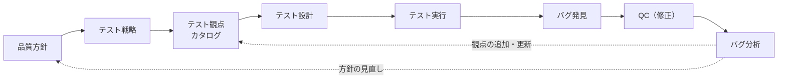

## 5-2. テスト観点を軸にした品質サイクル

テストケースは増やすものではない。磨くものだ。

### 21.5万件の事実

あるプロダクトのテストケースを分析したことがある。総数21.5万件。分析の結果、約75%が削減可能と判明した。

| 区分 | 割合 | 内容 |
|---|---|---|
| 重複テストケース | 30% | 別のテストケースと同じことを確認している |
| 目的不明のテストケース | 25% | 何のために存在するのかわからない |
| 他テストレベルでカバー済み | 20% | 単体テストで確認済みの内容を結合テストでも確認 |
| 有効なテストケース | 25% | 必要なテストケース |

21.5万件のうち、実際に必要だったのは約5万件。残りの16万件は、実行するだけで品質には貢献していなかった。

テストケースの件数が品質の指標になっていると、この構造に気づけない。「10,000件テストしました」が「2,500件で十分だった」に変わると、件数は減る。しかし品質は変わらない。件数が減ったことを「品質が下がった」と誤解する組織では、テストケースは増え続ける。

### テストケースが増え続ける構造

テストケースが増え続ける原因は3つある。

**原因1: 追加はあるが削除がない**。新機能のたびにテストケースが追加される。しかし、古い機能のテストケースは削除されない。「消すと品質が下がるかもしれない」という不安がある。品質サイクルがないと、この不安を解消できない。

**原因2: テストケースが属人的**。あの人が作ったテストケースは意図がわからないから消せない。テスト観点カタログがあれば、テストケースの意図（どの観点をカバーしているか）が明確になる。意図がわかれば、重複や不要の判断ができる。

**原因3: テストケースの件数が報告指標**。「今期のテストケース作成実績: 1,200件」。件数が評価指標になると、減らすインセンティブがない。品質サイクルを導入すると、指標が「件数」から「カバーしている観点の数」に変わる。観点カバレッジの方が品質を正確に表す。

### テストケース削減の具体的アプローチ

21.5万件のテストケースを75%削減したアプローチを紹介する。

**Phase 1: 棚卸し（2週間）**

全テストケースを4つに分類する。

| 分類 | 基準 | 対応 |
|---|---|---|
| A: 有効 | リスクが高い領域をカバー。過去にバグを検出 | 残す |
| B: 重複 | 同じ観点を別のテストケースが確認済み | 統合 |
| C: 目的不明 | なぜ存在するかわからない。作成者に聞いても不明 | 削除候補 |
| D: レベル不一致 | UTでカバーすべきことをE2Eで確認している | レベル移動 |

**Phase 2: 段階的削減（3ヶ月）**

1ヶ月目にC（目的不明）を削除。2ヶ月目にB（重複）を統合。3ヶ月目にD（レベル不一致）をUT/ITに移動。各月末にリリース後バグ率を確認し、悪化していないことを検証する。

**Phase 3: 維持（継続）**

品質サイクルの「Phase 4: 改善・更新」を毎スプリント回すことで、テストケースの数を一定に保つ。追加があれば、同数以上の削除候補を出す。

### 品質サイクルの構造

テストケースを「磨く」仕組みが品質サイクルだ。2つのループが交差する構造になっている。

**テストループ（左）**: テスト設計→テスト実行→結果記録→観点更新。テストを回すループ。

**QCループ（右）**: バグ報告→影響度判定→対処方針決定→再テスト。品質を診るループ。

2つのループの交差点に**テスト観点カタログ**がある。テストループからは「どんなテスト観点が有効だったか」が蓄積される。QCループからは「どんなバグが見つかったか、根本原因は何だったか」が蓄積される。

[第1章](/books/testing-not-equals-qa/chapter1)の定義に戻ると、テストループは「測る」活動。QCループは「診る」活動。そして品質サイクル全体を回す仕組みが「仕込む」＝QA活動だ。

### テスト観点カタログの具体的な構造

テスト観点カタログは特別なツールは不要だ。スプレッドシートで十分。

| 観点ID | 観点名 | カテゴリ | テストレベル | 優先度 | 最終更新 | 最終バグ |
|---|---|---|---|---|---|---|
| TP-001 | ログイン認証の正常系 | 認証 | E2E | 高 | 2026/09 | — |
| TP-002 | パスワードバリデーション | 認証 | UT | 中 | 2026/09 | — |
| TP-003 | 決済金額の正確性 | 決済 | IT+E2E | 最高 | 2026/10 | 2026/08 |
| TP-004 | 同時注文時の在庫整合性 | 決済 | IT | 高 | 2026/10 | 2026/09 |
| TP-005 | 画面遷移後の状態保持 | UI | E2E | 中 | 2026/07 | — |
| TP-006 | メール送信の文面 | 通知 | IT | 低 | 2026/06 | — |

カタログの各項目で注目すべきフィールド:

- **優先度**: テスト戦略のリスク判断に基づく。品質方針の上位項目に関わる観点は優先度「最高」
- **最終更新**: 長期間更新されていない観点は「本当にまだ必要か」を問い直す対象
- **最終バグ**: 最近バグが出た観点は、テスト密度を上げる候補

### カタログを育てる3つのイベント

カタログは放っておくと古くなる。3つのイベントでメンテナンスする。

**1. スプリントレビュー後（毎スプリント）**: 今スプリントで見つかったバグを分析し、カタログに新しい観点を追加するか、既存観点の優先度を調整する。5分で終わる。

**2. 障害発生時（イベント駆動）**: 障害が起きたら、その根本原因に対応する観点がカタログにあったかを確認する。なかったら追加。あったのにテストしていなかったなら、なぜスキップしたのかを振り返る。

**3. 四半期レビュー（定期）**: カタログ全体を見直す。6ヶ月以上更新されていない観点、バグが一度も出ていない低優先度の観点は、削除候補にする。カタログが膨れすぎると、21.5万件のテストケースと同じ問題が起きる。

### スプリントでの運用

品質サイクルを1スプリントの中で回す。4つのフェーズに分ける。

**Phase 1: 計画・設計**

スプリントの始まりに、テスト観点カタログから今回のテスト観点を選択する。新機能であれば新しい観点を追加し、改修であれば既存の観点から該当するものを選ぶ。

選択した観点をもとにテスト設計を行う。テストケースを新規に書くのではなく、観点をもとにテストの方針を決める。

**Phase 2: 実行・記録**

テストを実行し、結果を構造化して記録する。「Pass/Fail」だけでなく「どの観点で確認したか」「実行時に気づいたこと」も記録する。

**Phase 3: 分析・評価**

テスト結果を分析する。NGになったテストケースに対して「なぜNGになったか」を深掘りする。

NGを付けることがゴールではない。なぜNGになったかを掘ることが、テスト（＝測る）とQC（＝診る）の分岐点だ。「バグを見つけました」で終わるのがテスト。「このバグの影響度はCriticalだ、リリースを止める必要がある」と判断するのがQC。「同じパターンのバグが生まれない仕組みをつくる」のがQA。

**Phase 4: 改善・更新**

テスト観点カタログを更新する。今回有効だった観点はカタログに残す。不要だった観点は削除候補にする。新しく発見した観点は追加する。

この4フェーズを毎スプリント回すことで、テスト観点カタログが育っていく。テストケースの量ではなく、テスト観点の質で品質を守る状態になる。

### 品質サイクルの成熟度

品質サイクルの運用は段階的に成熟していく。6段階で現在地を確認しよう。

| レベル | 状態 | 目安 |
|---|---|---|
| Lv.0 | カタログなし | テストケースだけで運用。観点の概念がない |
| Lv.1 | カタログの種がある | スプレッドシートに50行。更新は不定期 |
| Lv.2 | スプリントで回している | Phase 1〜2が定着。テスト設計の起点にカタログを使う |
| Lv.3 | QCループが接続 | バグ→カタログ更新のフローが定着。Phase 3が機能 |
| Lv.4 | 棚卸しが定期化 | 四半期ごとにPhase 4を実施。カタログの数が安定 |
| Lv.5 | 品質戦略と連動 | カタログのデータがテスト戦略・品質方針の入力になっている |

Lv.0→Lv.1は1時間でできる。Lv.1→Lv.2は1ヶ月かかる。Lv.2→Lv.3はバグの出方によるが、2〜3ヶ月。Lv.3以降は半年〜1年の運用が必要だ。

ほとんどのチームはLv.0にいる。Lv.1に上げるだけでも、テスト設計の属人化が大幅に改善される。自分のチームが今どのレベルにいるか把握し、1つ上のレベルを目指すアクションを決めることが品質サイクル運用の出発点になる。一足飛びにLv.5を目指す必要はない。Lv.0からLv.1への1段が最も効果が大きい。

### 品質サイクルのBefore/After

品質サイクルを導入する前後で、テストの質がどう変わるか。

**Before（品質サイクルなし）**

| 項目 | 状態 |
|---|---|
| テスト設計の起点 | 前回のテストケースをコピー |
| 観点の選択基準 | 「前と同じ」 |
| バグの活用 | 修正して終わり |
| テストケースの数 | 増え続ける |
| テストの信頼度 | 不明 |

**After（品質サイクルあり）**

| 項目 | 状態 |
|---|---|
| テスト設計の起点 | テスト観点カタログから選択 |
| 観点の選択基準 | リスク×変更箇所×過去のバグ傾向 |
| バグの活用 | 根本原因を分析→カタログに観点追加 |
| テストケースの数 | 一定（不要な観点は削除） |
| テストの信頼度 | 品質方針に対する充足度で測定 |

### 品質サイクルの導入ステップ

いきなり4フェーズを全部回す必要はない。段階的に導入する。

**ステップ1（1ヶ月目）**: テスト観点カタログを作る。既存のテストケースから観点を逆抽出する。スプレッドシートに50行書き出すだけで、カタログの種ができる。

**ステップ2（2ヶ月目）**: テスト設計の起点をカタログにする。新しいテストケースを書くとき、まずカタログを確認する。「この観点はすでにカバーされているか」を先にチェックする。

**ステップ3（3ヶ月目）**: バグからカタログを更新する。バグが出たら「どの観点が不足していたか」を分析し、カタログに追加する。これでQCループとの接続が始まる。

**ステップ4（4ヶ月目〜）**: カタログの棚卸し。使われていない観点を削除候補にする。四半期ごとの見直しを定期イベントにする。

最初から完璧なサイクルを回そうとすると挫折する。ステップ1だけでも、テスト設計の属人化が減る。

### カタログ運用の失敗パターンと対策

カタログ運用で陥りがちな失敗パターンを4つ紹介する。

**失敗1: 完璧を目指して始められない**

「観点の粒度を揃えてから」「全機能分を洗い出してから」。完璧を目指すと永遠に始められない。最初は粗くていい。主要機能の観点を50個書き出すだけでカタログの種ができる。粒度は運用しながら揃えていけばいい。

**失敗2: 作った人しか更新しない**

カタログの管理がQAリードの1人に集中し、その人がいないと更新されない。対策は「バグが出たら、修正した開発者がカタログに1行追加する」ルール。カタログの更新をQAだけの仕事にしない。

**失敗3: 観点が増え続けて見通しが悪くなる**

四半期の棚卸しをスキップすると、不要な観点が蓄積する。カタログの行数が500を超えたら、カテゴリごとに分割するか、低優先度の観点をアーカイブするか検討する。

**失敗4: テストケースとの二重管理**

カタログとテストケースに同じ情報を二重管理している。カタログは「何を確認するか（観点）」、テストケースは「どう確認するか（手順）」。テストケースの「概要」列にカタログの観点IDを入れれば、紐づけだけで済む。

### テスト観点カタログの活用シーン

カタログは「テスト設計の起点」以外にも使い道がある。

**活用1: 影響範囲分析**

コードの変更があったとき「どの観点に影響があるか」をカタログで検索する。変更対象の機能に紐づく観点をリストアップし、その観点のテストケースを重点的に実行する。全件回帰テストではなく、影響のある観点だけの回帰テスト。効率が上がる。

**活用2: 新メンバーのオンボーディング**

新しいQAメンバーが入ったとき「このプロダクトでは何をテストするのか」をカタログで説明する。ベテランの頭の中にしかなかった暗黙知が、カタログとして言語化されている。オンボーディングの期間が短縮される。

**活用3: リスクの可視化**

カタログの各観点に「最終バグ日」を記録しておくと、リスクの高い領域が見える。「この半年でバグが5件出ている観点」はリスクが高い。「3年間バグが出ていない観点」はリスクが低い。テスト戦略のリスク判断にカタログのデータが使える。

**活用4: テスト設計レビュー**

テスト設計のレビューで「この機能に対して、カタログのどの観点をカバーしていますか？」と聞ける。抜け漏れの確認が構造的にできる。レビューアーの経験に依存しない。

### テスト観点カタログの導入事例

品質サイクルとカタログを導入したチームのBefore/Afterを3つ紹介する。

**事例1: モバイルアプリ開発チーム（5人）**

Before: テストケース3,000件。毎リリースで全件手動実行。2日間かかる。テスト設計はQAリード1人に依存。リリース後バグが月平均8件。

導入: テスト観点カタログ150行を作成。テストケースを3,000→1,200件に削減（UTカバー済み800件、重複500件、低リスク500件を削除）。

After（3ヶ月後）: テスト実行は1日で完了。浮いた1日で探索的テストを実施。リリース後バグは月平均3件に減少。テスト設計は全メンバーがカタログを参照して実施できるようになった。

**事例2: 業務用Webアプリ（BtoB・QA専任なし）**

Before: 開発者がテスト設計と実行を兼任。テスト観点は各開発者の頭の中にあり、担当者によってテストの質がバラバラ。リリース後に「この画面テストした？」「してなかった」が頻発。

導入: スプリントレトロスペクティブで10分を使い、その週見つかったバグを観点としてカタログに追加。最初は20行から始めた。

After（6ヶ月後）: カタログが80行に成長。新しいスプリントのテスト設計で「カタログのどの観点をカバーするか」を先に確認するフローが定着。「テストした？してなかった」が激減。

**事例3: マイクロサービス構成のSaaS（QAチーム3人）**

Before: サービス間連携のテストが属人的。「このサービス同士の連携は〇〇さんしか知らない」。連携テストの漏れが年に2回の障害につながっていた。

導入: サービス間連携の観点だけに特化した「連携カタログ」を作成。各サービスのAPIエンドポイント×呼び出し元の組み合わせをマトリクスで管理。60行。

After（4ヶ月後）: 新サービス追加時に「連携カタログにどの行が増えるか」を最初に確認するフローが定着。連携起因の障害が0件に。

3つの事例に共通するのは「小さく始めた」こと。最初から完璧なカタログを目指したチームは、事例として紹介できるような成功を収めていない。

### テスト観点の粒度

カタログの観点は粗すぎても細かすぎてもダメだ。

| 粒度 | 例 | 判定 |
|---|---|---|
| 粗すぎ | 「ログイン機能のテスト」 | ✗ 何をテストするかわからない |
| 適切 | 「ログイン認証の正常系」 | ○ テストケースを導出できる |
| 適切 | 「パスワード5回失敗時のロック」 | ○ 具体的で検証可能 |
| 細かすぎ | 「メールアドレス空欄でエラーメッセージ表示」 | ✗ テストケースと区別がつかない |

判断基準は「この観点から複数のテストケースを導出できるか」。1つしかテストケースが思い浮かばないなら、それは観点ではなくテストケースだ。逆に、10以上のテストケースが思い浮かぶなら、観点を分割した方がいい。

### テスト観点カタログと他の品質保証活動の接続

テスト観点カタログは単独で存在するのではなく、他の品質保証活動と接続して初めて本領を発揮する。

| 接続先 | 接続方法 | 効果 |
|---|---|---|
| テスト戦略（5-1） | カタログの観点にテスト戦略の優先順位を反映 | リスクベースの観点選択が機械的にできる |
| 品質方針（[第4章](/books/testing-not-equals-qa/chapter4)） | 品質方針の上位項目にカタログの観点を紐づけ | 品質方針が「お飾り」にならず、テスト設計に直結 |
| QA活動カタログ（[第3章](/books/testing-not-equals-qa/chapter3_1)） | 障害分析（QA活動）で発見した弱点をカタログに追加 | QA活動の成果がテスト設計に還元される |
| リリース判定 | カタログの必須観点がすべてカバーされているかで判定 | 判定基準が客観的になる |
| バグトリアージ | バグがカタログのどの観点に対応するかを記録 | バグの傾向分析が観点単位でできる |

カタログは品質サイクルの「ハブ」だと説明した。ハブが他の活動と接続されるほど、品質保証活動全体の効率が上がる。

**テスト観点カタログが接続しているときの流れ**

**品質サイクル接続フロー**

この流れが品質サイクルの全体像だ。テスト観点カタログが中央にいて、前段（品質方針・テスト戦略）と後段（テスト設計・実行）をつなぐ。バグが出たら、バグ分析を経てカタログが更新され、さらには品質方針やテスト戦略の見直しにもフィードバックされる。
